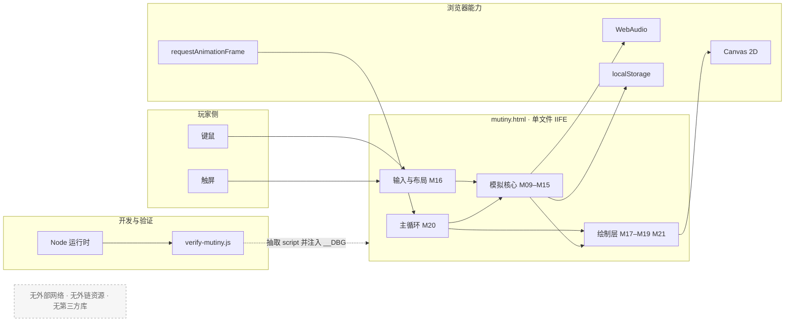
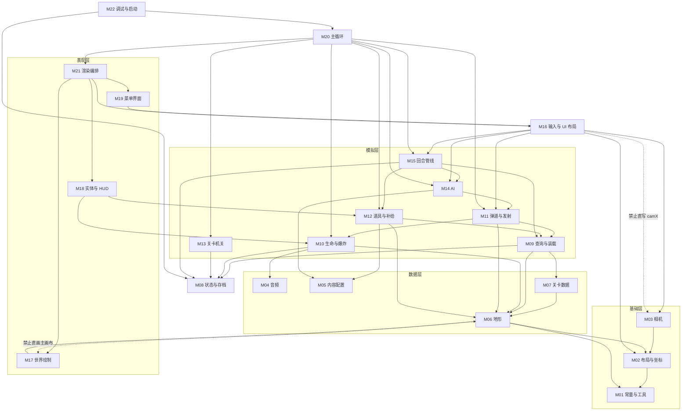
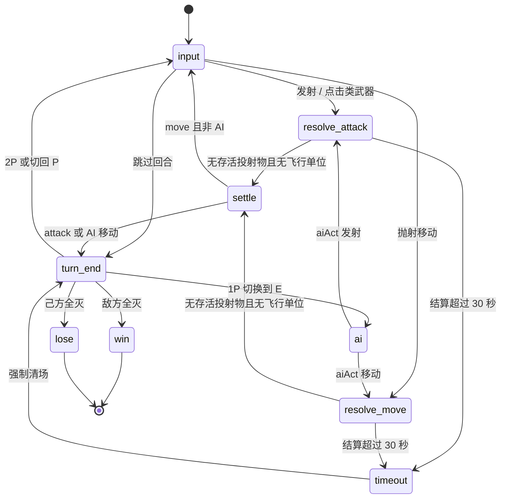
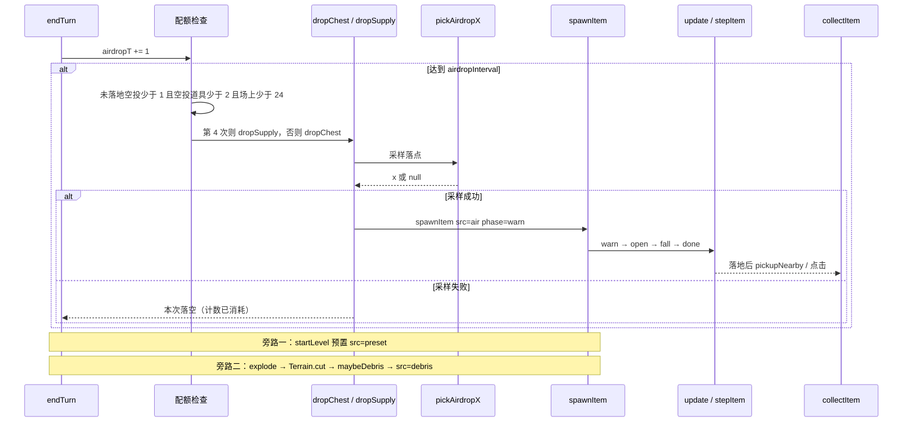

# project9 架构文档 — 海盗军团抢宝藏 · Mutiny 复刻版

> 文档版本：v1.0
> 对应代码基线：`mutiny.html` 3662 行；`tools/verify-mutiny.js` 990 行；验证结果 **229 通过 / 0 失败 / 21 组**（2026-10-19 实测）
> 最后更新：2026-10-19
> 读者：接手开发者、维护者、代码评审人
> 配套文档：[`REQUIREMENTS.md`](./REQUIREMENTS.md)（做什么）、[`../README.md`](../README.md)（怎么玩）、[`HANDOVER.md`](./HANDOVER.md)（踩坑与调试）

---

## 目录

- [0. 文档控制](#0-文档控制)
- [1. 范围与阅读路径](#1-范围与阅读路径)
- [2. 整体系统设计](#2-整体系统设计)
- [3. 模块划分](#3-模块划分)
- [4. 关键机制设计](#4-关键机制设计)
- [5. 模块间交互关系](#5-模块间交互关系)
- [6. 关键技术选型（ADR）](#6-关键技术选型adr)
- [7. 数据模型](#7-数据模型)
- [8. 可测试性设计](#8-可测试性设计)
- [9. 已知限制与技术债](#9-已知限制与技术债)
- [10. 扩展指南](#10-扩展指南)
- [附录 A 模块-符号-行号索引](#附录-a-模块-符号-行号索引)
- [附录 B 需求追溯入口](#附录-b-需求追溯入口)
- [附录 C 行号校准方法与基线快照](#附录-c-行号校准方法与基线快照)

---

## 0. 文档控制

### 0.1 与需求文档的分工

| 本文负责 | 本文不负责 |
| --- | --- |
| 系统上下文、分层、模块边界 | 需求编号、用户画像、验收标准 |
| 关键机制与算法 | 玩法教程与操作步骤 |
| 模块依赖、调用链、时序 | 数值定义（唯一真源在 `REQUIREMENTS.md` 附录 B） |
| ADR、数据模型、技术债 | 踩坑记录与调试技巧（在 `HANDOVER.md`） |

### 0.2 基线

| 项 | 值 |
| --- | --- |
| 游戏本体 | `mutiny.html`，3662 行，单 `<script>`，IIFE 范围 L28–L3659 |
| 验证器 | `tools/verify-mutiny.js`，990 行，21 组 229 断言 |
| 外部依赖 | 无（无 `package.json`、无构建、无 CDN） |
| 运行形态 | 浏览器直接打开 HTML；验证器用 Node 直接执行 |
| 文档基线日 | 2026-10-19 |

### 0.3 已知偏差（与代码实现相关的部分）

| 编号 | 偏差 | 架构含义 |
| --- | --- | --- |
| D-01 | `<title>`、头注释、菜单文案、console banner 仍写 v3 | 仅是文案，不影响模块与行为 |
| D-03 | 验证器 `[12]` 标题写「全 5 关」，实际遍历 15 关 | 测试命名陈旧，覆盖面正确 |
| D-04 | `LEVELS[].chapter/.diff/.wind` 运行时未读取 | 数据 schema 预留字段，属未接线 |

需求侧偏差的完整清单见 `REQUIREMENTS.md` §0.3。

### 0.4 变更记录

| 版本 | 日期 | 变更 |
| --- | --- | --- |
| v1.0 | 2026-10-19 | 初版：22 模块划分、4 张图、9 条 ADR、6 条调用链、数据模型与技术债 |

---

## 1. 范围与阅读路径

### 1.1 一句话架构

**单文件 IIFE + Canvas 全量重绘 + 数据驱动的回合制模拟核心 + 可注入随机的无头可测设计。**

没有模块系统、没有框架、没有运行时依赖。HTML 只保留两个节点：画布 `#cv` 与安全区探针 `#sa`；菜单、HUD、按钮、说明卡全部用 Canvas 图元绘制。所有状态集中在一个 `G` 对象里，所有配置集中在 6 张常量表里。

### 1.2 推荐阅读顺序

| 目的 | 读法 |
| --- | --- |
| 5 分钟了解全貌 | §2 → §3.2 模块表 → FIG-2 |
| 改一个武器 / 道具 | §10.1、§10.2 → §7.2 实体字段 → §5.2 开火调用链 |
| 排查回合卡住 | FIG-3 → §4.4 → §5.3 |
| 排查布局 / 触控 | §4.11 → §3.2 的 M02/M16 → §7.5 不变量 |
| 加一关 | §10.3 → §7.3 `LEVELS` schema |
| 接手整体重构 | §6 ADR（先看代价与复审条件）→ §9 技术债 |

### 1.3 代码阅读入口

```
L28   IIFE 开始
L35   常量
L58   布局与坐标
L341  Terrain
L518  LEVELS
L920  G
L1000 startLevel
L1123 explode
L1178 fireDrag
L1952 endTurn
L2002 输入
L3455 update
L3588 render
```

---

## 2. 整体系统设计

### 2.1 系统上下文（FIG-1）



**FIG-1 等价文字表**

| 节点 | 职责 | 依赖 |
| --- | --- | --- |
| 键鼠 / 触屏 | 产生 pointer / key 事件 | — |
| M16 输入与布局 | 坐标转换、命中判定、指针状态机 | M02、M03、M11、M14、M15 |
| M09–M15 模拟核心 | 地形、生命、弹道、道具、机关、AI、回合 | M05、M06、M07、M08 |
| M17–M19、M21 绘制 | 世界、实体、菜单、HUD | M06（只读地形位图）、M08 |
| M20 主循环 | 固定调用 `update` + `render` | 全部 |
| Canvas 2D | 主画布与离屏画布 | — |
| WebAudio | 18 个合成音效 | 首次手势后创建 |
| localStorage | 仅 `mutiny3.save` | 写入包 `try/catch` |
| verify-mutiny.js | 文本抽取 → 注入 → mock → eval | Node 内置 `fs`、`path` |

**关键约束**：图中没有网络节点，也没有资源加载节点。这是需求 NFR-02 的架构体现。

### 2.2 运行形态

| 形态 | 入口 | 说明 |
| --- | --- | --- |
| 正常游玩 | 双击 `mutiny.html` | 无服务器、无构建；`file://` 协议下完整可玩 |
| 带调试 | `mutiny.html?dbg` | 挂载 `window.__mutiny`，暴露 `L/VIEW/G` 与布局函数 |
| 无头验证 | `node tools/verify-mutiny.js` | mock 浏览器环境后执行真实源码 |

### 2.3 五层模型

| 层 | 模块 | 职责 | 允许依赖 |
| --- | --- | --- | --- |
| 基础层 | M01、M02、M03 | 常量、随机、布局、坐标、相机 | 无 |
| 数据层 | M05、M06、M07 | 配置表、地形、关卡 | 基础层 |
| 状态层 | M08 | `G` 与存档 | 基础层 |
| 模拟层 | M09–M15 | 查询、装载、生命、弹道、道具、机关、AI、回合 | 基础 / 数据 / 状态 |
| 表现层 | M17–M19、M21 | 世界、实体、菜单、HUD、说明卡 | 模拟层（只读）+ 基础层 |
| 输入层 | M16 | 事件 → 意图 → 模拟层调用 | 模拟层 + 基础层 |
| 编排层 | M20、M22 | 主循环与启动 | 全部 |

依赖方向单一：**上层可以读下层，下层不得反向调用上层**。表现层对模拟层只读，唯一例外是 `drawFog` 读单位位置（仍属只读）。

### 2.4 质量属性策略

| 质量属性 | 架构手段 | 对应需求 |
| --- | --- | --- |
| 可测试性 | `RNG` 可注入；`__DBG` 在启动前注入；模拟与绘制分离 | FR-17、NFR-10 |
| 确定性 | `rnd/rndi` 唯一随机出口；`hash1` 无状态噪声 | NFR-05 |
| 响应式 | `detectMode → calcLayout → syncView` 三段；`VIEW` 单一映射 | FR-14 |
| 一致性 | 布局函数化（绘制与命中同源）；相机唯一入口 | NFR-06 |
| 可破坏地形 | 像素碰撞权威 + 材质平行层 + 离屏渲染层 | FR-07 |
| 健壮性 | 存档 `try/catch`；落点四级降级；结算 30s 熔断 | NFR-08 |
| 零依赖 | 全程序化美术与音频，无外链 | NFR-02 |

---

## 3. 模块划分

### 3.1 划分原则

1. **一个模块 = 一份数据所有权 + 一个变更原因**。例如「地形」拥有 `data/mat/cv`，「回合」拥有阶段切换。
2. **按现有分区注释切分**，不凭空重划，保证行号可直接定位。
3. **单模块 30–530 行**；超过 400 行的模块（M12、M16、M18）内部已有子注释，可在不改文件的前提下按子段阅读。
4. **绘制与模拟分开**：同一实体在模拟层只有状态，在绘制层才有形状。
5. **配置与逻辑分开**：`WP / ITEM_DEF / DIFF / LEVELS` 是数据表，代码只消费不改写。

### 3.2 模块总表

行号连续覆盖 L35–L3661，无空洞、无重叠（L1–L34 为 head/style/banner，L3662 为 `</html>`）。

| ID | 模块 | 行号 | 职责 | 关键符号 |
| --- | --- | --- | --- | --- |
| M01 | 常量与工具 | 35–67 | 尺寸、物理常量、随机出口、哈希噪声 | `BASE_W/BASE_H` 36、`WORLD_H` 37、`W/H` 38、`WATER/GRAV/MAXPOW/POW2V` 39–42、`RNG` 47、`setRng` 48、`rnd` 52、`rndi` 53、`hash1` 56 |
| M02 | 布局与坐标 | 68–210 | 模式判定、布局计算、视口映射、坐标转换、字号工具 | `detectMode` 71、`safeInsets` 76、`calcLayout` 85、`syncView` 106、`setScreenTransform` 130、`setWorldTransform` 134、`resize` 142、`toGame` 161、`toWorld` 166、`fs/setFont/wfont/fitText` 170–188、`cancelPointer` 190、`queueResize` 200 |
| M03 | 相机 | 211–216 | 相机唯一写入口与边界钳制 | `camViewW` 212、`camMaxX` 213、`setCamX` 214、`centerCamX` 215 |
| M04 | 音频 | 217–260 | WebAudio 上下文、振荡器与噪声、18 个音效 | `AC` 218、`audio` 219、`tone` 221、`noise` 229、`S` 238 |
| M05 | 内容配置 | 261–340 | 武器、道具、难度、掉落、章节五张表 | `WP` 261、`WP_KEYS` 287、`ITEM_DEF` 294、`PICK_KINDS` 311、`LOOT_TABLE` 312、`RARE_WEAPONS` 313、`BARREL_KINDS` 314、`DIFF` 317、`D` 325、`DEBRIS_RATE` 328、`DEBRIS_*` 329–332、`CHAPTERS` 334 |
| M06 | 地形 | 341–501 | 像素碰撞层、材质层、离屏渲染、生成与破坏 | `MATS` 342、`MAT_CODE`、`class Terrain` 351、`solid` 360、`matAt` 365、`setPx/clrPx` 370–371、`surfaceY` 373、`rect` 390、`circle` 400、`blob` 409、`colFill` 440、`burn` 473、`cut` 480 |
| M07 | 关卡数据 | 502–918 | 15 关的地形生成函数、单位、道具、机关 | `makeTop` 502（死代码）、`LEVELS` 518 |
| M08 | 状态与存档 | 919–970 | 全局状态字面量、存档读写、战绩记录 | `G` 920、`save` 955、`loadSave` 956、`recordWin` 963 |
| M09 | 查询·队伍·装载 | 971–1037 | 地形查询封装、队伍工具、关卡装载 | `waterY` 972、`solidAt` 973、`groundYAt` 978、`surfaceY` 983、`solidUnder` 988、`alive` 994、`canMove` 995、`startLevel` 1000、`banner` 1036 |
| M10 | 生命·特效·爆炸 | 1038–1168 | 粒子、飘字、伤害、死亡、飞行物理、爆炸链 | `puff` 1039、`boomFx` 1044、`float` 1050、`hurt` 1054、`killUnit` 1071、`stepFlying` 1079、`pickupNearby` 1115、`explode` 1123、`triggerMine` 1156、`destroyCrate` 1162 |
| M11 | 弹道与发射 | 1169–1357 | 投射物工厂、弹簧方向、四类发射入口、步进与引爆 | `spawnProj` 1170、`slingDir` 1173、`fireDrag` 1178、`throwSelf` 1203、`fireClick` 1216、`fireVoodoo` 1240、`useWeapon` 1251、`stepProj` 1257、`startRoll` 1333、`hitBoulder` 1334、`detonate` 1338、`endAfter` 1356 |
| M12 | 道具供给与拾取 | 1358–1690 | 道具工厂、空投三通道、状态机、危险物、拾取分发、破坏掉落 | `itemRemove` 1359、`spawnItem` 1361、`pickAirdropX` 1381、`dropChest` 1415、`dropSupply` 1422、`stepItem` 1434、`detonateBarrel` 1493、`resolveCollector` 1524、`collectItem` 1530、`applyBuff` 1566、`debrisChance` 1642、`dominantMat` 1652、`maybeDebris` 1657 |
| M13 | 关卡机关 | 1691–1760 | 迷雾、岩浆、雷暴、涨潮的推进与判定 | `inHazard` 1692、`stormStrike` 1700、`pickStormX` 1707、`updateHazards` 1713 |
| M14 | AI | 1761–1950 | 弹道模拟、误差、攻击评分、移动决策、执行 | `simShot` 1762、`getAiErr` 1776、`shotAim` 1783、`aiChoose` 1789、`aiPlanThrow` 1863、`itemWorth` 1884、`aiMove` 1901、`aiAct` 1926 |
| M15 | 回合管线 | 1951–2001 | 胜负判定、空投计数、换边、回合初重置 | `endTurn` 1952、`skipTurn` 1998 |
| M16 | 输入与 UI 布局 | 2002–2436 | 三档布局函数、命中判定、指针状态机、键盘 | `uiButtons` 2011、`hitBtn` 2073、`getTools` 2081、`layoutToolbar` 2086、`toolBtnAt` 2113、`layoutLevels` 2122、`layoutDifficulty` 2155、`layoutHUD` 2173、`unitAt` 2210、`itemAt` 2221、`hudBtnAt` 2227、`ptrBegin` 2253、`ptrEnd` 2260、`dragThr` 2251 |
| M17 | 世界绘制 | 2437–2615 | 天空、水、装饰、箱子、机关、迷雾 | `rr` 2438、`drawSky` 2440、`drawWater` 2516、`drawDeco` 2531、`drawCrates` 2552、`drawHazards` 2561、`drawFog` 2590 |
| M18 | 实体与 HUD 绘制 | 2616–3143 | 道具图标与状态、海盗、投射物、爆炸、瞄准、HUD | `drawParachute` 2617、`drawItemIcon` 2649、`drawItems` 2746、`drawPirate` 2767、`drawProj` 2854、`drawBooms` 2888、`drawMines` 2901、`drawFires` 2911、`drawAim` 2924、`hazardText` 2984、`drawHUD` 2994、`drawBtn` 3132 |
| M19 | 菜单界面 | 3144–3444 | 菜单、选关、难度、帮助、结算 | `menuScale` 3145、`menuBg` 3147、`wrapText` 3167、`drawMenu` 3181、`drawLevels` 3219、`drawDifficulty` 3273、`helpRows` 3322、`drawHelp` 3352、`drawEnd` 3427 |
| M20 | 主循环 | 3445–3517 | 帧调度、更新管线、resolve 状态机 | `frame` 3447、`update` 3455 |
| M21 | 说明卡·补边·渲染编排 | 3518–3642 | 悬停命中、说明卡、留白补边、渲染分层 | `hoverItem` 3521、`drawItemTip` 3530、`coverBand` 3571、`render` 3588 |
| M22 | 调试与启动 | 3643–3661 | `?dbg` 钩子、存档加载、首帧 | `window.__mutiny` 3645、启动段 3651–3659 |

**非运行时模块**：`tools/verify-mutiny.js`（990 行）。它不参与运行时依赖，只通过 `__DBG` 契约读取内部符号。

### 3.3 依赖规则

| 规则 | 说明 | 违反后果 |
| --- | --- | --- |
| R-1 | 依赖只能指向下层；表现层不得被模拟层调用 | 模拟逻辑依赖绘制，无法无头测试 |
| R-2 | 地形只画到自己的离屏 `cv`，不得直画主画布 | 相机与视口变换会双重生效 |
| R-3 | 任何模块不得直写 `G.camX`，必须走 `setCamX/centerCamX` | 越界、缩放后视野错位 |
| R-4 | 配置表（M05/M07）不得反向调用运行时函数 | 数据加载顺序耦合、循环依赖 |
| R-5 | 随机必须走 `rnd/rndi`（音频噪声除外） | 固定种子失效，测试不确定 |
| R-6 | UI 几何只能由 `layoutXxx()` 产出 | 绘制与命中漂移，点击点不中 |

### 3.4 模块依赖图（FIG-2）



**FIG-2 等价文字表（关键边）**

| 调用方 | 被调用方 | 说明 |
| --- | --- | --- |
| M20 主循环 | M10–M15、M21 | `update` 推进模拟，`render` 编排绘制 |
| M21 渲染编排 | M17、M18、M19、M16 | 按屏幕态选择菜单或世界层，再叠 HUD |
| M16 输入 | M11、M14、M15、M03、M02 | 把事件翻译成发射、行动、换边、相机移动 |
| M15 回合 | M12、M14、M08、M09 | 空投计数、AI 触发、存档、存活判定 |
| M11 弹道 | M10、M09、M06 | 命中转伤害、地面查询、地形破坏 |
| M12 道具 | M09、M06、M05 | 落点查询、材质统计、配置读取 |
| M14 AI | M11、M05 | 复用发射入口与难度参数 |
| M06 地形 | M01、M02 | 只用常量与坐标工具 |

### 3.5 边界争议裁决

| 争议 | 裁决 | 理由 |
| --- | --- | --- |
| `Terrain` 属数据层还是模拟层 | 数据层（M06） | 它只拥有像素数据与查询，不含回合逻辑；爆炸在 M10 |
| `S` 音效由谁调用 | 实现归 M04，调用散落在模拟层 | 音效是副作用，但若集中到表现层会丢失「事件发生点」语义 |
| `maybeDebris` 属道具还是爆炸 | M12 | 它拥有道具生成策略与预算状态；爆炸只负责把 `cutInfo` 传进来 |
| `layoutXxx` 属绘制还是输入 | M16（输入与 UI 布局） | 它是几何唯一来源，必须同时服务绘制与命中，独立成层 |
| `render` 属哪层 | M21 | 它只做编排与变换，具体绘制在 M17/M18/M19 |
| 存档属状态还是功能 | M08 | `G` 与 `save/loadSave` 共享同一份字段定义，拆开会产生双写 |

---

## 4. 关键机制设计

### 4.1 三层尺寸

代码里有三个容易混淆的「宽度」概念，必须严格区分：

| 名称 | 含义 | 是否随屏幕变化 | 用途 |
| --- | --- | --- | --- |
| `BASE_W/BASE_H` = 960/560 | 桌面设计基准 | 否 | 桌面逻辑分辨率、横屏世界宽 |
| `WORLD_H` = 560 | 世界高度 | **永不变化** | 地形高度、水位、雷暴光柱 |
| `W/H`（`let`） | 画布逻辑尺寸 | 是 | UI 坐标系、清屏范围 |

`Terrain` 内部一律使用 `WORLD_H`，不引用 `H`——这是 v5 改造的核心前提。若地形高度随屏幕变化，同一关在手机与桌面上会生成不同地形，破坏公平性。

### 4.2 `VIEW` 世界视口

```js
VIEW = { w, h, s, y, rect:{x,y,w,h} }
```

| 字段 | 含义 |
| --- | --- |
| `w/h` | 可见世界宽高（世界单位） |
| `s` | 世界 → 画布像素的等比缩放 |
| `y` | 可见区域在世界中的顶部坐标 |
| `rect` | 视口在画布上的矩形（屏幕逻辑坐标） |

不变量（每次 `syncView` 后必须成立）：

```
rect.w === w * s
rect.h === h * s
rect.x >= band.x && rect.x + rect.w <= band.x + band.w
rect.y >= band.y && rect.y + rect.h <= band.y + band.h
```

三档取值：

| 模式 | `s` | `w` | `h` | `y` |
| --- | --- | --- | --- | --- |
| desktop | 1 | 960 | 560 | 0 |
| compact | `W / 960` | 960 | `min(H/s, 560)` | 垂直居中 |
| portrait | `clamp` 计算 | 480–620 | `min(band.h/s, 560)` | 底部对齐（`WORLD_H - h`） |

竖屏把 `y` 贴底，是因为海面在世界底部；贴底可保证「水面永远可见」，否则玩家看不到落水。

### 4.3 坐标三段转换

```
浏览器 client 坐标
   │  toGame(e)：减 getBoundingClientRect，按 cssW/cssH 归一
   ▼
画布逻辑坐标（UI 坐标系，0..W / 0..H）
   │  toWorld(s)：反解 rect 与 camX/VIEW.y
   ▼
世界坐标（0..mapW / 0..WORLD_H）
```

| 函数 | 行号 | 方向 |
| --- | --- | --- |
| `toGame` | 161 | client → 画布逻辑 |
| `toWorld` | 166 | 画布逻辑 → 世界 |

绘制时方向相反，由两个变换函数完成：

| 函数 | 行号 | 作用 |
| --- | --- | --- |
| `setScreenTransform` | 130 | `setTransform(cssScale×dpr)`，UI 坐标即 CSS 像素 |
| `setWorldTransform` | 134 | 叠加 `VIEW.s`、`-camX`、`-VIEW.y`、震屏偏移 |

**为什么必须两套变换**：世界层需要相机与缩放，HUD 需要固定像素尺寸。若共用一个变换，HUD 会随缩放变大变小，字会糊。

### 4.4 地形双层 + 材质平行层

```
Terrain
├── data: Uint8Array(mapW × 560)   0 空 / 1 实心     ← 碰撞唯一权威
├── mat : Uint8Array(mapW × 560)   0 空 / 1草 2沙 3岩 4木 5雪
└── cv  : 离屏 canvas(mapW × 560)                    ← 渲染层 + 小地图纹理
```

| 操作 | `data` | `mat` | `cv` |
| --- | --- | --- | --- |
| `setPx` | 写 | 写 | 不写（批量绘制） |
| `rect/circle/blob/colFill` | 写 | 写 | 写（base + top 两层） |
| `burn` | 不改 | 不改 | `source-atop` 画焦痕 |
| `cut` | 清 | 清 | `destination-out` 挖洞 |

`cut` 同时统计被清除像素的材质分布，返回 `{total, counts[0..5]}`，供 `debrisChance` 使用。这样「看到的洞」与「掉落的概率依据」来自同一次操作，不会出现「画了洞但碰撞还在」。

### 4.5 回合状态机（FIG-3）



**FIG-3 等价文字表**

| 当前态 | 事件 | 下一态 | 代码位置 |
| --- | --- | --- | --- |
| `input` | `fireDrag` / `fireClick` / `fireVoodoo` | `resolve`（`resolveKind='attack'`） | M11 各入口 |
| `input` | `throwSelf` | `resolve`（`resolveKind='move'`） | 1203 |
| `input` | `skipTurn` | `turn_end` | 1998 |
| `resolve` | `!busy && resolveWait<=0` 且 `move` 且非「1P 的 E 队」 | `input` | 3510–3513 |
| `resolve` | `!busy && resolveWait<=0` 且 `attack` | `turn_end` | 3514 |
| `resolve` | `resolveT > 30` | `turn_end`（先清投射物与飞行） | 3504–3507 |
| `turn_end` | 敌方 `alive` 为空 | `win` | 1957–1961 |
| `turn_end` | 己方 `alive` 为空 | `lose` | 1956 |
| `turn_end` | 1P 且轮到 E | `ai`（`aiTimer=0.9×delayMul`） | 1977 |
| `turn_end` | 2P 或切回 P | `input` | 1978–1982 |
| `ai` | `aiTimer<=0` → `aiAct` | `resolve` | 3498 |

**三个正交状态机**，不要混在一张图里：

| 状态机 | 取值 | 语义 |
| --- | --- | --- |
| `G.screen` | menu / levels / difficulty / help / play / win / lose | 页面级 |
| `G.phase` | input / ai / resolve / over | 回合级 |
| `G.pointer.phase` | idle / aiming / panning | 单次指针交互 |

### 4.6 弹道、命中与结算屏障

**弹簧反向**（`slingDir`，1173）：

```
dx  = unit.x - drag.x
dy  = (unit.y - 30) - drag.y      // 支点在身体上方 30
pow = clamp(hypot(dx, dy), 12, MAXPOW)
v   = normalize(dx, dy) × pow × POW2V
```

拖拽点在海盗左下方，则 v 指向右上方。预览、发射、AI 共用这一个函数，是「手感一致」的根因。

**发射四入口**

| 入口 | 行号 | 适用 | 结算类型 |
| --- | --- | --- | --- |
| `fireDrag` | 1178 | `aim='drag'` | `attack` |
| `throwSelf` | 1203 | 移动工具 | `move` |
| `fireClick` | 1216 | `aim='click'` | 强制 `attack` |
| `fireVoodoo` | 1240 | `aim='unit'` | `attack` |

`fireClick` 必须显式设置 `resolveKind='attack'`，否则「先移动后埋雷」会沿用上一次的 `move`，白赚一次行动——这是 v4 的真实 bug。

**结算屏障**

```
busy = 存在 alive 的投射物 || 存在 alive 且 fly 的单位
resolve 结束条件 = !busy && resolveWait <= 0
resolveWait 下限 = 0.35s（endAfter 保证）
硬熔断 = resolveT > 30s
```

屏障解决的是异步竞态：投射物可能引发连锁爆炸，飞行单位可能撞到另一个单位再触发爆炸。只有全部落地才换边，状态才收敛。

### 4.7 爆炸、连锁与破坏掉落

`explode(x, y, r, dmg, team, mul)`（1123）是一个**扇出函数**，一次调用触发六件事：

| 顺序 | 动作 | 说明 |
| --- | --- | --- |
| 1 | 爆炸特效 | `boomFx` |
| 2 | 地形烧焦 + 挖洞 | `burn(r×0.78)` + `cut(r×0.78)`，`cutInfo` 留用 |
| 3 | 单位伤害 / 同队击飞 | 伤害按 `1 - d/r` 衰减；同队非飞行单位被弹飞 |
| 4 | 连锁地雷 | `r+26` 内 `triggerMine` |
| 5 | 连锁危险桶 | `r+30` 内 `detonateBarrel` |
| 6 | 摧毁箱子、炸飞道具 | 箱子 `r+18`；非桶道具进入飞行 |
| 7 | 破坏掉落 | `maybeDebris(x, y, cutInfo)`，带深度保护 |

**破坏掉落的五重门控**（`maybeDebris`，1657）：

```
1. 深度：G._explodeDepth <= DEBRIS_MAX_DEPTH(3)
2. 规模：cut.total >= DEBRIS_MIN_PX(80)
3. 冷却：now - lastDebris >= DEBRIS_COOLDOWN(0.6s)
4. 预算：G.debrisBudget > 0
5. 上限：场上 src='debris' 数量 < DEBRIS_MAX_FIELD(6)
```

**概率模型**（`debrisChance`，1642）：

```
lambda = Σ count[m] × DEBRIS_RATE[m] / 100
areaBonus = 1 + clamp((total - 1500) / 10000, 0, 0.35)
p = clamp((1 - e^(-lambda)) × areaBonus × D().dropMul, 0, 0.35)
```

即「被炸掉的材质越多、木质占比越高，掉落概率越大」，并封顶 35%。落点还要避开水、机关、已有可拾取物 130 范围内、单位 70 范围内。

### 4.8 道具与宝箱三通道（FIG-4）



**FIG-4 等价文字表**

| 阶段 | 参与符号 | 关键判定 |
| --- | --- | --- |
| 计数 | `endTurn` 1964–1975 | 只在 P 方回合结束时 +1 |
| 配额 | `endTurn` 1967–1969 | 未落地空投 < 1、空投道具总数 < 2、场上道具 < 24 |
| 选型 | `endTurn` 1971 | `airdropCount % 4 === 0` → `dropSupply`，否则 `dropChest` |
| 落点 | `pickAirdropX` 1381 | 四级降级：40 次择优（坡度 ≤70 且不挤人）→ 放宽坡度 ≤130 → 全图 20px 扫描取最靠上 → 放弃避让只保证不落水不入机关 |
| 生成 | `spawnItem` 1361 | 写入 `src='air'`、`phase='warn'`、`para=true` |
| 状态机 | `stepItem` 1434 | `warn(1.2s，鹦鹉 3.7s) → open(0.3s) → fall → done` |
| 拾取 | `pickupNearby` / 点击 | 最终都进 `collectItem` 1530 |
| 配额受阻 | `endTurn` 的 else 分支 | `airdropT = interval - 1`，下回合重试 |
| 采样失败 | `pickAirdropX` 返回 `null` | 本次落空；计数已消耗，等下个周期 |
| 落水 | `stepItem` 的 `sink` | 下沉后 `itemRemove` |

**三条通道的分工**

| 通道 | 触发 | 数量控制 | 内容倾向 |
| --- | --- | --- | --- |
| 预置 `preset` | `startLevel` 读 `LEVELS.items` | 关卡设计固定 | 教学与节奏控制 |
| 空投 `air` | 回合计数 + 配额 | 未落地 1、空投总数 2、场上 24 | 宝箱为主，每第 4 次补给 |
| 破坏 `debris` | 爆炸挖洞 + 五重门控 | 冷却 0.6s、场上 6、深度 3、关卡预算 | 材质决定种类：木质偏宝箱 |

### 4.9 AI 决策管线

```
endTurn 切到 E
   → phase='ai'，aiTimer = 0.9 × delayMul
   → update 倒计时归零
   → aiAct
        ├─ aiChoose：枚举「武器 × 敌人」候选并评分
        │     ├─ anchor 88（头顶无遮挡；队友在目标附近降为 40）
        │     ├─ shot 92（连线无遮挡，解析弹道）
        │     ├─ voodoo 70
        │     ├─ mine 38（面朝方向 30–60 可埋）
        │     └─ 其他：角度 × 力度网格 → simShot → 115 - 落点距离（<26 取 115，否则上限 76）
        ├─ 排序取最高 → 注入误差（角度 ±getAiErr，力度 ±err/2）
        ├─ 若 planScore < atkThresh → 尝试 aiMove
        │     ├─ itemWorth 评分（宝箱 100、黄金 130、朗姆按血量 95/42…）
        │     ├─ 机会成本门控：planScore ≥ atkThresh×0.55 时 gate=88
        │     └─ aiPlanThrow 网格搜索落点，距道具 <46 才接受
        └─ 按 aim 分派 fireClick / fireVoodoo / fireDrag / throwSelf
```

**误差模型**（`getAiErr`，1776）：

```
base = clamp(0.15 - 0.006 × 关卡序号, 0.06, 0.15)
err  = base × aimMul
迷雾关卡 +0.02
敌方持有望远镜 ×0.75
```

关卡越高越准，难度档再乘系数（简单 1.55 → 困难 0.60）。

### 4.10 确定性随机

| 符号 | 行号 | 作用 |
| --- | --- | --- |
| `RNG` | 47 | 当前随机源，默认 `Math.random` |
| `setRng(fn)` | 48 | 注入；传空回退 |
| `resetRng()` | 49 | 复位 |
| `rnd(a,b)` | 52 | 唯一消费 `RNG()` 的地方 |
| `rndi(a,b)` | 53 | 闭区间整数，内部调 `rnd` |
| `hash1(n)` | 56 | 无状态确定性噪声（星点、云、地形起伏） |

业务代码共 44 个抽取点（`rnd` 32 + `rndi` 12）。音频噪声（229）刻意使用 `Math.random`，与模拟隔离——声音不需要可复现，也不应该消耗测试的随机序列。

### 4.11 响应式布局与指针状态机

**布局三段**

```
resize()
  → detectMode(vw, vh)        // portrait / compact / desktop
  → calcLayout(vw, vh)        // 产出 L：W/H/cssScale/k/minFont/band/headerH/toolbarH
  → syncView()                // 产出 VIEW，并重新钳制 camX
  → setScreenTransform()      // UI 变换
```

**三档布局参数**

| 项 | portrait | compact | desktop |
| --- | --- | --- | --- |
| 逻辑尺寸 | 视口宽高 | 视口宽高 | 960×560 |
| `cssScale` | 1 | 1 | 0.6–1.6 |
| 顶栏 | 112 + 安全区 | 0 | 0 |
| 底栏 | 126 + 安全区 | 56 + 安全区 | 70 |
| 工具栏 | 5 列多行，格 ≥44×52 | 单行，56×46 | 单行，54×50 |
| 视野宽 | 480–620 | 960 | 960 |
| 字号 | 原生 CSS px，下限 10 | ×0.95，下限 9 | 下限 9 |

**布局函数化**

| 函数 | 服务的界面 | 绘制侧 | 命中侧 |
| --- | --- | --- | --- |
| `uiButtons` | 菜单 / 选关 / 难度 / 帮助 / 结算 | `drawBtn` | `hitBtn` |
| `layoutToolbar` | 对局工具栏 | `drawHUD` | `toolBtnAt` |
| `layoutLevels` | 选关 | `drawLevels` | `levelCardAt` |
| `layoutDifficulty` | 难度 | `drawDifficulty` | `difficultyCardAt` |
| `layoutHUD` | 信息卡 / 小地图 / 触屏按钮 | `drawHUD` | 输入路由、`hudBtnAt` |

这是 v5 消除「看到的位置 ≠ 点到的位置」的根本手段：几何只算一次。

**指针状态机**

```
idle ──按下──> aiming（拉弓 / 巫毒）
             └ panning（空白拖拽，可携带一次延迟点按）
抬起：位移 < 8 CSS px → 视为点按；否则视为拖拽
```

| 入口 | 行号 | 职责 |
| --- | --- | --- |
| `ptrBegin` | 2253 | 记录 `pointerId/type/起点/startCam`，尝试 `setPointerCapture` |
| `ptrEnd` | 2260 | 复位 id / phase / tap / moved |
| `dragThr` | 2251 | `8 / cssScale`，把 CSS 阈值换到逻辑坐标 |
| `pointerdown` | 2262 | 音频解锁 → 香蕉引爆 → 按钮 → 页面路由 → HUD → 小地图 → 工具栏 → 瞄准 |
| `pointermove` | 2366 | 更新坐标、判定拖动、平移相机、更新瞄准、hover |
| `pointerup` | 2385 | tap 与拖拽分流；执行延迟动作；松手发射 |
| `pointercancel` | 2416 | 清帮助拖拽 + `cancelPointer` |
| `lostpointercapture` | 2418 | 按下中丢失捕获则取消 |

**触屏放大的命中区**

| 对象 | 鼠标 | 触屏 |
| --- | --- | --- |
| 道具 | 半径 28 | 半径 36 |
| 单位 | 半径 30 | `30 + 10/VIEW.s` |
| 工具格 | 外扩 2px | 外扩 6–8px |
| HUD 按钮 | — | 外扩 4px |

### 4.12 渲染管线

```
render()
  ├─ setScreenTransform + clearRect
  ├─ 菜单类界面 → 各自绘制并 return
  ├─ coverBand：天空/深水色补 letterbox
  ├─ 裁剪到 VIEW.rect
  │    └─ setWorldTransform
  │         drawSky → 地形位图 → 装饰 → 箱子 → 机关 → 地雷
  │         → 单位 → 道具 → 火焰 → 投射物 → 爆炸 → 水
  │         → 粒子 → 飘字 → 瞄准线
  ├─ setScreenTransform + drawFog（屏幕空间挖视野孔）
  └─ setScreenTransform + drawHUD → drawItemTip → drawEnd
```

| 顺序要点 | 原因 |
| --- | --- |
| 水在单位与投射物之后 | 水下物体被水面覆盖，视觉上「沉下去」 |
| 迷雾在屏幕层用 `destination-out` 挖孔 | 避免在世界层反复裁剪，孔洞始终是圆形屏幕区域 |
| 地形只 `drawImage(G.T.cv)` | 地形像素已在其离屏画布上合成，主画布不再逐像素画 |
| HUD 最后画 | UI 永远压在游戏内容上 |

### 4.13 音频合成

| 组成 | 说明 |
| --- | --- |
| `AC` | 单例 AudioContext，首次 `pointerdown` 创建/恢复 |
| `tone(f,dur,type,vol,slide)` | 振荡器 + 指数衰减包络 + 可选滑音 |
| `noise(dur,vol,fLow)` | 白噪声缓冲 + 低通 |
| `S` | 18 个音效的组合配置（click/pick/aim/whoosh/shot/boom/bounce/splash/hurt/die/chest/coin/rum/fire/place/crumble/win/lose） |

没有音频文件，因此不存在加载失败、跨域、格式兼容问题；代价是音色较简单，且无法做复杂混音。

---

## 5. 模块间交互关系

### 5.1 静态依赖矩阵

按层聚合（`→` 直接调用，`⇢` 只读数据，`×` 禁止）：

| 调用方 \ 被调方 | 基础 M01–03 | 数据 M05–07 | 状态 M08 | 模拟 M09–15 | 输入 M16 | 表现 M17–19/21 | 编排 M20 |
| --- | --- | --- | --- | --- | --- | --- | --- |
| 基础 M01–03 | — | × | × | × | × | × | × |
| 数据 M05–07 | → | ⇢ | × | × | × | × | × |
| 状态 M08 | → | ⇢ | — | × | × | × | × |
| 模拟 M09–15 | → | ⇢ | → | → | × | × | × |
| 输入 M16 | → | ⇢ | → | → | — | × | × |
| 表现 M17–21 | → | ⇢ | ⇢ | ⇢ | → | → | × |
| 编排 M20 | → | ⇢ | → | → | × | → | — |

矩阵中两个 `×` 需要特别强调：

- **模拟层不得调用表现层**：否则无法在 Node 中跑 `update`。
- **数据层不得调用状态层**：否则 `LEVELS` 的 `gen()` 会依赖 `G`，加载顺序变脆。

### 5.2 一次 `drag` 类开火

```
pointerdown
  → toGame(161) → toWorld(166)
  → 命中判定：uiButtons / layoutHUD / layoutToolbar / unitAt
  → ptrBegin(2253) 记录 sx/sy/startCam
  → 进入 aiming，G.dragAim=true

pointermove
  → 位移 > dragThr(2251) 时置 moved=true
  → 更新 G.aimX/aimY

pointerup
  → 读取 pow = dist(aim, unit)
  → pow < 14 → 取消，回到 idle
  → pow >= 14 → fireDrag(1178)
        → slingDir(1173) 求方向与力度
        → useWeapon(1251) 扣弹
        → spawnProj(1170)
  → G.phase='resolve'，G.resolveKind='attack'

update(3455)
  → stepProj(1257) 逐帧
        → 命中单位 → hurt(1054) → killUnit(1071)
        → 触地/引信 → detonate(1338) → explode(1123)
              → Terrain.cut(480) → {total, counts}
              → hurt / 击飞 / 连锁 / 炸飞道具
              → maybeDebris(1657) → spawnItem(1361)
  → busy=false 且 resolveWait<=0
  → endTurn(1952)
```

### 5.3 一次 `click` / `unit` 类开火

```
fireClick(1216)
  → 校验落点：surfaceY(983) / waterY(972)，水面则提示并保持 input
  → 按 kind 分支：
        anchor → spawnProj 从屏幕上方下落
        mine   → G.mines.push
        crate  → G.crates.push（受 max=3 限制）
  → 强制 resolveKind='attack'（防止沿用 move）

fireVoodoo(1240)
  → 校验 G.voodoo 仍存活
  → slingDir(1173) 求方向
  → 目标 u.fly=true，hurt(1054, 30)
  → phase=resolve，resolveKind='attack'
```

### 5.4 一个回合的生命周期

```
endTurn(1952)
  ├─ phase==='over' → return
  ├─ resolveKind='attack'（复位默认值）
  ├─ alive('P')===0 → screen=lose, phase=over
  ├─ alive('E')===0 → screen=win, phase=over
  │     → recordWin(963) → 解锁 → save(955)
  ├─ turnTeam==='P' → 空投计数（1964–1975）
  ├─ 1P：P→E 则 phase=ai, aiTimer=.9×delayMul
  │      E→P 则 turns++, phase=input
  ├─ 2P：直接换边，phase=input
  └─ 回合初重置
        → 行动方 frozen/rageT/hasteT/shieldT 递减
        → 全员 moved=false, movesUsed=0
        → assist/scout 递减
        → sel/selW/aimX/aimY/voodoo/dragAim 清空
        → resolveT=0

update(3455) 中 AI 段
  → phase==='ai' 且 aiTimer<=0
  → phase='resolve', resolveWait=.2
  → aiAct(1926)
        → aiChoose(1789) → simShot(1762) → getAiErr(1776)
        → 若分数低 → aiMove(1901) → aiPlanThrow(1863)
        → 分派 fireClick / fireVoodoo / fireDrag / throwSelf
```

### 5.5 一次空投

```
endTurn → airdropT >= airdropInterval
  → 配额检查（airborne<1 && airItems<2 && items<24）
  → airdropCount++ → 第 4 次 ? dropSupply : dropChest
  → pickAirdropX(1381)
        1) 40 次随机采样，取「坡度 ≤70 且不挤人」中评分最高者
        2) 放宽坡度阈值到 130，取首个合法列
        3) 全图 20px 扫描，取最靠上且不挤人的平台
        4) 放弃避让，任取不落水、不入机关的列
        5) 仍无解 → null（本次落空，计数已消耗）
  → spawnItem(kind, x, y, {src:'air', phase:'warn', para:true})
  → stepItem(1434)
        warn 1.2s（鹦鹉 3.7s）→ open 0.3s → fall（重力 + 摆动）→ done
  → 落地：pickupNearby(1115) 或点击
  → collectItem(1530) → collectChest / applyBuff / …
```

### 5.6 一次爆炸到掉落

```
stepProj → detonate(1338)
  → 火瓶：留下火海；银币：范围伤害；其他：explode(1123)
  → explode
        ├─ Terrain.burn(r×0.78) + Terrain.cut(r×0.78) → cutInfo
        ├─ 单位伤害（距离衰减） + 同队击飞
        ├─ 连锁：triggerMine / detonateBarrel / destroyCrate
        ├─ 炸飞非桶道具
        └─ maybeDebris(x, y, cutInfo)
              ├─ 深度 / 规模 / 冷却 / 预算 / 上限
              ├─ debrisChance(counts)
              ├─ 6 次落点尝试（避水、避机关、避已有道具 130、避单位 70）
              ├─ dominantMat 决定种类（木质 67% 宝箱）
              └─ spawnItem(src='debris')
```

### 5.7 一次 resize

```
window.resize / orientationchange / visualViewport.resize
  → queueResize（rAF 去抖）
  → resize(142)
        → detectMode(71) → calcLayout(85) → L
        → cv.width = cssW × dpr（dpr ≤ 2）
        → syncView(106) → VIEW
        → setCamX(G.camX) 重新钳制
        → setScreenTransform
        → 模式或逻辑尺寸变化时 cancelPointer + fogCv=null
        → 保持世界中心：centerCamX(旧中心)
  → 下一帧 render → coverBand(3571) 补边
```

---

## 6. 关键技术选型（ADR）

> 每条固定五栏：背景 → 决策 → 放弃的备选 → 理由 → 代价与复审条件。

### ADR-01 单文件 HTML + 内联 CSS/JS + IIFE

| 项 | 内容 |
| --- | --- |
| 背景 | 目标用户要求「点开就玩」，分发渠道是链接或文件 |
| 决策 | 全部代码内联进一个 HTML，外层 IIFE 包裹，零全局变量 |
| 放弃的备选 | 多文件 + Vite/Rollup 打包；原生 ES Module + 本地服务器 |
| 理由 | 无构建、无服务器、无跨域；单文件可直接邮件/网盘传输；`file://` 下可运行 |
| 代价与复审 | 3662 行单文件、行号耦合、无法按文件分层；若引入构建链、多人并行开发或需要 tree-shaking，重新评审 |

### ADR-02 Canvas 2D 全量重绘

| 项 | 内容 |
| --- | --- |
| 背景 | UI 与游戏世界需要统一坐标、统一命中，且有大量像素级特效 |
| 决策 | 每帧 `clearRect` 后按层序重绘全部内容；菜单、HUD、按钮也用 Canvas 画 |
| 放弃的备选 | DOM/CSS 做 UI + Canvas 做世界；WebGL；脏矩形增量重绘 |
| 理由 | 绘制与几何同源，缩放/相机只需变换矩阵；道具图标、海盗、地形全部程序化，无贴图管线 |
| 代价与复审 | 每帧整图绘制，无 GPU 批处理；文本排版需手写截断与折行；若地图或单位数量翻倍、或需要复杂滤镜，重新评审 |

### ADR-03 地形三层：碰撞数组 + 材质数组 + 离屏画布

| 项 | 内容 |
| --- | --- |
| 背景 | 需要「炸出真实的洞」，且洞要与碰撞一致，还要按材质决定掉落 |
| 决策 | `Uint8Array data`（碰撞权威）+ `Uint8Array mat`（材质）+ 离屏 canvas（渲染） |
| 放弃的备选 | 多边形地形 + 物理引擎（如 Matter.js）；每帧从 canvas 读回像素判断碰撞 |
| 理由 | 像素级挖洞天然一致；材质统计只多一个数组；读回像素太慢且受合成模式影响 |
| 代价与复审 | 内存随 `mapW×560` 线性增长；无斜面与刚体；若需要更复杂物理或更大的地图，重新评审 |

### ADR-04 变步长 `dt`，上限 50ms

| 项 | 内容 |
| --- | --- |
| 背景 | 浏览器帧率波动，暂停/切后台会产生巨大 `dt` |
| 决策 | `dt = min((now - last)/1000, 0.05)`，直接推进物理 |
| 放弃的备选 | 固定步长累加器（`accumulator += dt; while(acc >= 1/60) step()`） |
| 理由 | 实现简单；低帧时降速而非穿透；回合制对物理精度要求低于实时竞技 |
| 代价与复审 | 物理不完全帧率无关，极端低帧下弹道略有差异；若加入录像回放或高精度竞技，重新评审 |

### ADR-05 弹簧反向瞄准统一走 `slingDir`

| 项 | 内容 |
| --- | --- |
| 背景 | 原作的核心手感是「把弹簧拉向反侧」，且预览、发射、AI 必须一致 |
| 决策 | 单一函数 `slingDir(u, tx, ty)` 产出方向与力度，所有入口复用 |
| 放弃的备选 | 正向拖拽即发射方向；每种武器各写一套瞄准 |
| 理由 | 三个消费者共享一条数学路径，不会出现「预览向左、实际向右」；AI 也能直接复用 |
| 代价与复审 | 新用户需要学习反向操作；触屏上容易误解；若增加「正向模式」选项，需要在此处分支 |

### ADR-06 `input → resolve → 换边` 结算屏障

| 项 | 内容 |
| --- | --- |
| 背景 | 投射物会引发连锁爆炸、飞行单位会撞人再引爆，异步回调难以收敛 |
| 决策 | 用显式阶段机替代定时器；`resolve` 以「无存活投射物且无飞行单位」为结束条件 |
| 放弃的备选 | `setTimeout` 编排换边；事件驱动（每个投射物结束时发事件计数） |
| 理由 | 消除竞态；任意连锁深度都收敛到同一条件；便于无头测试直接推进 |
| 代价与复审 | 需要 `resolveWait` 保底展示与 30s 熔断；玩家可能感到等待；若加入可打断动作或实时元素，重新评审 |

### ADR-07 可注入 RNG，`rnd/rndi` 为唯一出口

| 项 | 内容 |
| --- | --- |
| 背景 | 宝箱、掉落、AI 误差都是概率行为，需要可复现才能写断言 |
| 决策 | `let RNG = Math.random`，`setRng(fn)` 注入，`rnd/rndi` 是唯一消费点 |
| 放弃的备选 | 直接调用 `Math.random`；引入 seedrandom 等库 |
| 理由 | 零依赖；测试可让概率判定必然发生或必然不发生；`hash1` 提供不消耗序列的确定性噪声 |
| 代价与复审 | 纪律成本：新代码若绕过出口，测试会失真；音频噪声是显式例外；若引入 Web Worker 多线程模拟，需要重新设计随机源隔离 |

### ADR-08 响应式：模式判定 + `VIEW` 单一映射 + 布局函数化

| 项 | 内容 |
| --- | --- |
| 背景 | 同一套游戏要跑在 320 宽手机、844×390 横屏与 1920 桌面 |
| 决策 | `detectMode → calcLayout → syncView` 三段；`VIEW` 唯一世界映射；每个 UI 簇单一 `layoutXxx()`；常量三层拆分 |
| 放弃的备选 | CSS 媒体查询 + DOM 按钮；每档写一套绘制代码；按比例缩放整个画布（桌面也会被放大到失真） |
| 理由 | 全 Canvas UI 无法用 CSS 布局；布局函数化让绘制与命中同源；`WORLD_H` 恒定保证各端地形一致 |
| 代价与复审 | 三档分支多、字号需三件套补偿、CJK 截断要手写；若改用 DOM UI 或引入响应式框架，重新评审 |

### ADR-09 无头验证器：文本抽取 + `__DBG` 注入 + mock + `eval`

| 项 | 内容 |
| --- | --- |
| 背景 | 单文件 IIFE 没有导出，常规单元测试无法触达内部函数 |
| 决策 | 用正则提取 `<script>`，在启动标记前注入 `globalThis.__DBG={...}`，mock 浏览器 API 后 `eval` |
| 放弃的备选 | 拆模块 + Jest/Vitest；Puppeteer 端到端；在源码里长期挂 `window.__DBG` |
| 理由 | 零构建；测的是真实源码而非副本；Node 直跑，秒级反馈；不污染正常运行的全局 |
| 代价与复审 | 依赖启动锚点字符串与约 90 个手工导出符号，重构易碎；失败信息只有断言文案；若拆模块或接入 CI，重新评审 |

---

## 7. 数据模型

### 7.1 `G` 全局状态分组

`G` 字面量 54 个字段（920–952），另有 3 个运行时补充字段。

| 组 | 字段 | 所有权 |
| --- | --- | --- |
| 流程 | `screen`、`mode`、`phase`、`turnTeam`、`turns`、`banner`、`bannerT` | M15 / M20 |
| 关卡进度 | `lvIndex`、`unlocked`、`difficulty`、`pendingLevel`、`records` | M08 / M09 |
| 世界与相机 | `T`、`mapW`、`camX`、`waterY`、`hazards` | M03 / M06 / M13 |
| 实体容器 | `units`、`projs`、`booms`、`mines`、`fires`、`crates`、`items`、`parts`、`floats` | M10 / M11 / M12 |
| 选择与瞄准 | `sel`、`selW`、`aimX`、`aimY`、`voodoo`、`dragAim` | M16 |
| 指针与悬停 | `mouse`、`pointer`、`hoverBtn` | M16 |
| 结算与计时 | `resolveWait`、`resolveT`、`aiTimer`、`shake`、`time` | M20 |
| 空投与掉落 | `airdropT`、`airdropInterval`、`airdropCount`、`debrisBudget`、`debrisCount`、`lastDebris`、`_explodeDepth` | M12 |
| 增益辅助 | `assist`、`scout` | M12 |
| 帮助页 | `helpPage`、`helpScroll`、`helpMax`、`helpDrag` | M19 |
| 运行时补充 | `_deco`、`resolveKind`、`diffFrom` | M09 / M11 / M16 |

`G.records` 结构：

```js
{
  "3": { "easy": { win: 2, best: 9 }, "normal": { win: 1, best: 12 } },
  "4": { "hard": { win: 1, best: 15 } }
}
```

### 7.2 实体字段

**unit**（`startLevel` 1011–1018 创建）

| 字段 | 含义 |
| --- | --- |
| `id`、`t`、`x`、`y` | 标识、队伍（P/E）、世界坐标 |
| `hp`、`maxHp` | 当前/最大生命 |
| `cap` | 船长标记（体型与绘制不同） |
| `w` | 武器弹药表，值为弹药数量或 `Infinity`（无限） |
| `alive`、`fly`、`flyT` | 存活、飞行态、飞行计时 |
| `moved`、`movesUsed`、`moveMax` | 本回合移动状态 |
| `shield`、`shieldT` | 护盾值与剩余回合 |
| `rageT`、`hasteT` | 狂暴/疾行剩余回合 |
| `frozen`、`freezeResist` | 冻结剩余回合、抗性 |
| `scrollUsed` | 卷轴是否已用 |
| `vx`、`vy` | 飞行速度 |
| `face`、`flash`、`bob` | 朝向、受击闪白、呼吸浮动 |

**item**（`spawnItem` 1361）

| 字段 | 含义 |
| --- | --- |
| `kind`、`x`、`y`、`w` | 种类、坐标、重量 |
| `vx`、`vy`、`fly`、`landed` | 飞行与落地状态 |
| `src` | 来源：`preset` / `air` / `debris` / `loot` |
| `phase`、`t` | 空投状态机阶段与计时 |
| `para`、`sway` | 降落伞与摆动 |
| `tier` | 宝箱档位 |
| `sink`、`sinkT` | 落水下沉 |
| `flashT`、`triggered`、`dead` | 拾取闪光、触发标记、待移除 |

**projectile**（`spawnProj` 1170 及 `fire*`）

| 字段 | 含义 |
| --- | --- |
| `trail`、`alive`、`t` | 拖尾点、存活、存活时间 |
| `x`、`y`、`vx`、`vy` | 位置与速度 |
| `wx`、`team`、`kind`、`dmg`、`r` | 武器 key、队伍、弹道类型、伤害、半径 |
| 可选 | `bounces`、`fuse`、`mul`、`coin`、`opened`、`rolling` |

**hazard**

| 类型 | 字段 |
| --- | --- |
| `fog` | `alpha`、`radius` |
| `magma` | `zones:[{x,y,w,h}]` |
| `storm` | `period`、`dmg`、`r`、`warnT`、`warnX` |
| `tide` | `period`、`low`、`high`、`rise`、`hold`、`fall`、`phaseT` |

### 7.3 `LEVELS` schema

| 字段 | 必需 | 类型 | 说明 |
| --- | --- | --- | --- |
| `name` | 是 | string | 关卡名 |
| `theme` | 是 | string | 10 种主题之一 |
| `mapW` | 是 | number | 1600–2600 |
| `sky` | 是 | `[string,string]` | 天空渐变两端 |
| `gen(T, deco)` | 是 | function | 调用 Terrain API 生成地形，可推装饰 |
| `units` | 是 | array | `{t,x,hp,cap?,baseShield?,w}` |
| `items` | 是 | array | `{kind,x,y?,tier?}` |
| `chapter` | 否 | number | **仅元数据，运行时不读** |
| `diff` | 否 | number | **仅元数据，运行时不读** |
| `debrisChests` | 否 | number | 破坏掉落预算基数 |
| `airdropEvery` | 否 | number | 空投间隔基数 |
| `hazards` | 否 | array | 机关实例 |
| `lootBias` | 否 | number | 黄金宝箱概率加成 |
| `wind` | 否 | number | **仅第 13 关有，运行时不读** |

### 7.4 存档 schema

```js
localStorage['mutiny3.save'] = {
  v: 2,                    // 版本
  u: 7,                    // 已解锁关数（1..15）
  rec: {                   // 每关每档战绩
    "5": { "normal": { win: 1, best: 11 } }
  }
}
```

兼容路径：

| 输入 | 行为 |
| --- | --- |
| `null` | 默认 `unlocked=1`、`records={}` |
| `{u:4}`（旧格式，无 `v`） | 恢复 `unlocked=4`，不恢复战绩 |
| `{v:2,u,rec}` | 全量恢复 |
| 非法 JSON | `try/catch` 吞掉，按默认处理 |
| `u` 越界 | `clamp(u, 1, LEVELS.length)` |

### 7.5 不变量清单

| 编号 | 不变量 | 违反表现 |
| --- | --- | --- |
| I-1 | `VIEW.rect.w === VIEW.w × VIEW.s` | 画面拉伸、点击偏移 |
| I-2 | `VIEW.rect.h === VIEW.h × VIEW.s` | 同上 |
| I-3 | `VIEW.rect` 完全落在 `L.band` 内 | 内容画进 HUD 区 |
| I-4 | `WORLD_H` 恒为 560 | 各端地形不一致 |
| I-5 | `VIEW.w ∈ [480, 620]`（竖屏） | 手机上看不到对手或视野过宽 |
| I-6 | `G.camX ∈ [0, mapW - VIEW.w]` | 露黑边或越界 |
| I-7 | 水面只经 `waterY()` 读取 | 涨潮时部分判定不跟随 |
| I-8 | 地形 `data` 是碰撞唯一权威 | 「看得见洞、撞得到墙」 |
| I-9 | `rnd/rndi` 之外不消费 `RNG` | 固定种子失效 |
| I-10 | `G.phase='resolve'` 时必有投射物或飞行单位（或 `resolveWait>0`） | 卡在结算态 |

---

## 8. 可测试性设计

### 8.1 验证器原理

```
1. fs.readFileSync('mutiny.html')
2. 正则贪婪提取 <script>...</script> 的内容
3. 字符串替换：在 '/* ---------- 启动 ---------- */' 前插入
      globalThis.__DBG = { G, LEVELS, WP, ..., setRng, resetRng };
4. 构造 mock：window / document / canvas 2d context / localStorage(Map) / RAF / performance
5. eval(src)
6. const D = globalThis.__DBG
7. 按 21 组执行断言，累计通过/失败
```

关键 mock：

| API | 实现要点 |
| --- | --- |
| `document.getElementById` | 按 id 缓存同一个 fakeCanvas |
| `document.createElement` | 返回 fakeCanvas（Terrain 需要） |
| Canvas 2D context | no-op `Proxy`；特判 `canvas`、渐变对象、`measureText` |
| `getBoundingClientRect` | 跟随 `style.width/height`，默认 960×560（`toGame` 依赖） |
| `localStorage` | Map 支撑的完整实现 |
| `requestAnimationFrame` | 空函数（避免自动跑帧） |
| `AudioContext` | `undefined`（音效走空实现） |

### 8.2 `__DBG` 契约

导出约 90 个符号，分四类：

| 类别 | 代表符号 |
| --- | --- |
| 状态 | `G`、`LEVELS`、`WP`、`WP_KEYS`、`ITEM_DEF`、`DIFF`、`MATS`、`CHAPTERS` |
| 布局 | `VIEW`、`resize`、`detectMode`、`toGame`、`toWorld`、`setCamX`、`camViewW`、`getLayout`、5 个 `layoutXxx` |
| 模拟 | `startLevel`、`endTurn`、`fireDrag`、`fireClick`、`fireVoodoo`、`throwSelf`、`useWeapon`、`update`、`explode`、`stepProj`、`stepItem`、`hurt`、`maybeDebris` |
| 测试支撑 | `setRng`、`resetRng`、`getAiErr`、`alive`、`solidAt`、`unitAt`、`itemAt`、`render` |

契约是**单向**的：验证器依赖游戏内部符号，游戏不感知验证器。新增可测能力时，只需在导出清单里补一行。

### 8.3 为可测性付出的设计约束

| 约束 | 原因 |
| --- | --- |
| 模拟与绘制分离 | Node 环境下 ctx 是 no-op，`update` 必须不依赖绘制结果 |
| 随机走统一出口 | 否则无法用 `setRng` 控制概率分支 |
| 启动代码必须带固定注释锚点 | 注入点依赖字符串匹配 |
| 地形生成必须可在无 canvas 环境执行 | fakeCanvas 的 ctx 是 no-op，但 `data/mat` 必须真实写入 |
| 布局函数必须是纯几何计算 | 测试直接调用即可验证不变量，不需渲染 |

---

## 9. 已知限制与技术债

### 9.1 死代码与未接线字段

| 项 | 位置 | 说明 | 建议 |
| --- | --- | --- | --- |
| `makeTop(pts)` | 502 | 定义后无引用 | 删除或接入 `colFill` |
| `isPickable(kind)` | 1492 | 定义后无引用（实际用 `ITEM_DEF[kind].pick`） | 统一为一个入口 |
| `PICK_KINDS` | 311 | 计算后无引用 | 删除或在 UI 中使用 |
| `MAT_NAME` | 350 | 定义后无引用 | 删除或用于调试输出 |
| `MOVE_COST_TURN` | 288 | 定义后无引用 | 删除或接入 `canMove` |
| `G.chestCount` | 937 / 1024 | 只写不读 | 删除或用于统计面板 |
| `drawItems` 的 `it.source` | 2762 | 字段名应为 `src`，该分支永不成立 | 改为 `it.src` |
| `LEVELS[].chapter` / `.diff` | 多处 | 仅元数据，运行时不读 | 若要按章解锁，需接线 |
| `LEVELS[].wind` | 832 | 第 13 关定义但从未读取 | 接入风场或删除 |

### 9.2 设计取舍（非缺陷）

| 项 | 现状 | 说明 |
| --- | --- | --- |
| 2P 迷雾 | `drawFog` 只给 P 队挖视野孔 | 双人模式下 E 队视野不可见，属取舍；若要做对称，需要按 `turnTeam` 切换 |
| 2P 战绩 | 双人胜利也会 `recordWin` | 是否应计入单人战绩待产品确认 |
| 性能未实测 | 无帧率/内存基准 | 地形整图 `drawImage`，更大规模需分块 |
| AI 平衡 | 依赖人肉试玩 | 参数集中在 `DIFF`，便于调参，但不承诺胜率 |
| 音频音色 | 合成音较简单 | 无音频文件是刻意选择 |

### 9.3 结构性风险

| 风险 | 触发条件 | 缓解 |
| --- | --- | --- |
| 行号漂移 | 任何插入/删除 | 模块用区间 + 符号名双定位；附录 C 提供校准命令 |
| 单文件膨胀 | 继续加内容 | 按 M01–M22 保持分区注释；超过 5000 行考虑拆文件 |
| `__DBG` 导出遗漏 | 新增内部函数 | 改动后跑验证器；新增测试时同步补导出 |
| 布局三档分叉 | 新增控件 | 必须走 `layoutXxx()`，禁止在绘制里写坐标 |

---

## 10. 扩展指南

### 10.1 加一种武器

1. 在 `WP`（261）新增条目：`name/icon/color/dmg/r/aim/kind/desc`，必要时加 `bounces/n/max`。
2. 若 `kind` 是新的弹道行为，在 `stepProj`（1257）加分支；若复用现有 `kind`，无需改。
3. 若 `aim` 是新的瞄准方式，需在 `pointerdown/up` 与 AI 分派处各加一条。
4. 若要出现在宝箱池，确认 `WP_KEYS` 自动包含（`Object.keys`）；若要进稀有池，改 `RARE_WEAPONS`（313）。
5. 跑 `[4][5][11][18]`。

### 10.2 加一种道具

1. 在 `ITEM_DEF`（294）新增条目：`name/cat/pick/w/desc`。
2. 在 `collectItem`（1530）加分支；增益类可复用 `applyBuff`（1566）。
3. 若要进空投补给池，加入 `LOOT_TABLE`（312）；若要作为危险物，加入 `BARREL_KINDS`（314）并在 `detonateBarrel`（1493）加分支。
4. 在 `drawItemIcon`（2649）加图标绘制分支。
5. 若可拾取，确认 `hoverItem/drawItemTip` 能显示说明。
6. 跑 `[7][14][15][16]`。

### 10.3 加一关

1. 在 `LEVELS`（518）追加对象，必需字段见 §7.3。
2. `gen(T, deco)` 只用 Terrain API（`rect/circle/blob/colFill`），不要直接改 `data`。
3. `units` 的 `w` 用 `{key: 数量 | Infinity}`；敌方血量会被 `hpMul` 再乘一次。
4. `items` 的坐标要落在站立面上，可在 `startLevel` 后用 `surfaceY` 校验。
5. 若要加机关，`hazards` 用 §7.2 的结构；`type` 必须是已实现的四种之一。
6. 更新 `CHAPTERS`（334）的 `to` 边界。
7. 跑 `[2][12][18]`，并检查 `unlocked` 上限是否随之变化（`LEVELS.length` 自动生效）。

### 10.4 加一种机关

1. 在 `LEVELS[].hazards` 里能表达数据结构。
2. 在 `updateHazards`（1713）加推进逻辑；只改 `G.waterY` 或调用 `hurt`，不要直接改单位坐标。
3. 在 `drawHazards`（2561）加可视层。
4. 在 `inHazard`（1692）加判定（影响落点采样与掉落避让）。
5. 在 `hazardText`（2984）加 HUD 文案。
6. 跑 `[18][20]`。

---

## 附录 A 模块-符号-行号索引

> 本附录是行号的唯一真源。行号变更时只改这里，其他章节引用符号名。

### A.1 基础与配置

| 符号 | 行号 | 模块 |
| --- | ---: | --- |
| `BASE_W / BASE_H` | 36 | M01 |
| `WORLD_H` | 37 | M01 |
| `W / H` | 38 | M01 |
| `WATER / GRAV / MAXPOW / POW2V` | 39–42 | M01 |
| `UNIT_R / EDGE / CAMSPD` | 43–44 | M01 |
| `RNG / setRng / resetRng` | 47–49 | M01 |
| `rnd / rndi / hash1` | 52–56 | M01 |
| `detectMode` | 71 | M02 |
| `safeInsets` | 76 | M02 |
| `calcLayout` | 85 | M02 |
| `syncView` | 106 | M02 |
| `setScreenTransform / setWorldTransform` | 130 / 134 | M02 |
| `resize` | 142 | M02 |
| `toGame / toWorld` | 161 / 166 | M02 |
| `fs / setFont / wfont / fitText` | 170 / 171 / 172 / 177 | M02 |
| `cancelPointer / queueResize` | 190 / 200 | M02 |
| `camViewW / camMaxX / setCamX / centerCamX` | 212–215 | M03 |
| `S` 音效表 | 238 | M04 |
| `WP / WP_KEYS` | 261 / 287 | M05 |
| `ITEM_DEF` | 294 | M05 |
| `PICK_KINDS / LOOT_TABLE / RARE_WEAPONS / BARREL_KINDS` | 311–314 | M05 |
| `DIFF / D` | 317 / 325 | M05 |
| `DEBRIS_RATE / DEBRIS_*` | 328–332 | M05 |
| `CHAPTERS / chapterOf` | 334 / 339 | M05 |
| `MATS / MAT_CODE / MAT_NAME` | 342–350 | M06 |
| `class Terrain` | 351 | M06 |
| `Terrain.solid` | 360 | M06 |
| `Terrain.surfaceY` | 373 | M06 |
| `Terrain.rect / circle / blob` | 390 / 400 / 409 | M06 |
| `Terrain.colFill` | 440 | M06 |
| `Terrain.burn / cut` | 473 / 480 | M06 |
| `makeTop`（死代码） | 502 | M07 |
| `LEVELS` | 518 | M07 |
| `G` | 920 | M08 |
| `save / loadSave / recordWin` | 955 / 956 / 963 | M08 |
| `waterY / solidAt / groundYAt` | 972 / 973 / 978 | M09 |
| `surfaceY / solidUnder` | 983 / 988 | M09 |
| `alive / canMove` | 994 / 995 | M09 |
| `startLevel / banner` | 1000 / 1036 | M09 |
| `hurt / killUnit` | 1054 / 1071 | M10 |
| `stepFlying / pickupNearby` | 1079 / 1115 | M10 |
| `explode / triggerMine / destroyCrate` | 1123 / 1156 / 1162 | M10 |
| `spawnProj / slingDir` | 1170 / 1173 | M11 |
| `fireDrag / throwSelf / fireClick / fireVoodoo` | 1178 / 1203 / 1216 / 1240 | M11 |
| `useWeapon / stepProj` | 1251 / 1257 | M11 |
| `detonate / endAfter` | 1338 / 1356 | M11 |
| `spawnItem` | 1361 | M12 |
| `pickAirdropX / dropChest / dropSupply` | 1381 / 1415 / 1422 | M12 |
| `stepItem` | 1434 | M12 |
| `detonateBarrel` | 1493 | M12 |
| `collectItem / applyBuff` | 1530 / 1566 | M12 |
| `debrisChance / dominantMat / maybeDebris` | 1642 / 1652 / 1657 | M12 |
| `inHazard / updateHazards` | 1692 / 1713 | M13 |
| `simShot / getAiErr / aiChoose` | 1762 / 1776 / 1789 | M14 |
| `aiPlanThrow / itemWorth / aiMove / aiAct` | 1863 / 1884 / 1901 / 1926 | M14 |
| `endTurn / skipTurn` | 1952 / 1998 | M15 |
| `uiButtons / hitBtn` | 2011 / 2073 | M16 |
| `layoutToolbar / toolBtnAt` | 2086 / 2113 | M16 |
| `layoutLevels / layoutDifficulty` | 2122 / 2155 | M16 |
| `layoutHUD / unitAt / itemAt / hudBtnAt` | 2173 / 2210 / 2221 / 2227 | M16 |
| `dragThr / ptrBegin / ptrEnd` | 2251 / 2253 / 2260 | M16 |
| `drawSky / drawWater / drawDeco / drawCrates` | 2440 / 2516 / 2531 / 2552 | M17 |
| `drawHazards / drawFog` | 2561 / 2590 | M17 |
| `drawParachute / drawItemIcon / drawItems` | 2617 / 2649 / 2746 | M18 |
| `drawPirate / drawProj` | 2767 / 2854 | M18 |
| `drawAim / hazardText / drawHUD / drawBtn` | 2924 / 2984 / 2994 / 3132 | M18 |
| `menuScale / menuBg / wrapText` | 3145 / 3147 / 3167 | M19 |
| `drawMenu / drawLevels / drawDifficulty` | 3181 / 3219 / 3273 | M19 |
| `helpRows / drawHelp / drawEnd` | 3322 / 3352 / 3427 | M19 |
| `frame / update` | 3447 / 3455 | M20 |
| `hoverItem / drawItemTip` | 3521 / 3530 | M21 |
| `coverBand / render` | 3571 / 3588 | M21 |
| `window.__mutiny` / 启动段 | 3645 / 3651–3659 | M22 |

### A.2 关键常量速查

| 常量 | 值 |
| --- | --- |
| `BASE_W × BASE_H` | 960 × 560 |
| `WORLD_H` | 560 |
| `WATER` | 468 |
| `GRAV` | 620 |
| `MAXPOW` | 175 |
| `POW2V` | 4.4 |
| `UNIT_R` | 15 |
| `EDGE / CAMSPD` | 42 / 430 |
| 结算保底 / 熔断 | 0.35s / 30s |
| 点按阈值 | 8 CSS px |
| DPR 上限 | 2 |

---

## 附录 B 需求追溯入口

需求 ID、验收标准与覆盖形态的唯一真源在 [`REQUIREMENTS.md` 附录 C](./REQUIREMENTS.md#附录-c-追溯矩阵)。此处只给反向索引，不复制验证组与 AC。

| 模块 | 主要相关需求 |
| --- | --- |
| M01 常量与工具 | FR-05.2、NFR-05 |
| M02 布局与坐标 | FR-14.2、FR-14.3、FR-14.6、NFR-06 |
| M03 相机 | FR-06.1、FR-06.2 |
| M04 音频 | FR-15.1、FR-15.2、FR-15.3 |
| M05 内容配置 | FR-02.4、FR-08.1、FR-09.1、FR-10.3、FR-12.1 |
| M06 地形 | FR-07.1–FR-07.5、FR-10.6 |
| M07 关卡数据 | FR-02.1、FR-11.5 |
| M08 状态与存档 | FR-02.2、FR-02.6、FR-13.1–FR-13.5 |
| M09 查询与装载 | FR-04.6、FR-07.4、FR-07.5、FR-10.1 |
| M10 生命与爆炸 | FR-04.1–FR-04.6、FR-07.3、FR-10.6 |
| M11 弹道与发射 | FR-03.1、FR-05.1–FR-05.7、FR-08.2–FR-08.6 |
| M12 道具与补给 | FR-09.1–FR-09.8、FR-10.2–FR-10.7 |
| M13 关卡机关 | FR-11.1–FR-11.5 |
| M14 AI | FR-12.1–FR-12.7 |
| M15 回合管线 | FR-02.2、FR-02.5、FR-03.1–FR-03.6、FR-10.2 |
| M16 输入与 UI 布局 | FR-06.3、FR-06.4、FR-14.1–FR-14.9 |
| M17 世界绘制 | FR-07.2、FR-11.1、FR-11.3、FR-16.4 |
| M18 实体与 HUD 绘制 | FR-04.1、FR-09.8、FR-10.5、FR-16.4、FR-16.5 |
| M19 菜单界面 | FR-02.3、FR-02.4、FR-16.1、FR-16.2 |
| M20 主循环 | FR-03.2、FR-03.3 |
| M21 渲染编排 | FR-16.3、FR-14.2 |
| M22 调试与启动 | FR-01.1、FR-01.3、FR-17.4 |

---

## 附录 C 行号校准方法与基线快照

### C.1 校准命令

```bash
# 文件规模
wc -l mutiny.html tools/verify-mutiny.js

# 分区注释（模块边界的权威来源）
grep -n "^/\* ---------- " mutiny.html

# 函数定义（符号行号）
grep -n "^function \|^class " mutiny.html

# 单个符号定位
grep -n "function maybeDebris" mutiny.html
grep -n "const DIFF" mutiny.html

# 断言结果
node tools/verify-mutiny.js
```

### C.2 基线快照

| 项 | 2026-10-19 |
| --- | --- |
| `mutiny.html` | 3662 行 |
| `verify-mutiny.js` | 990 行 |
| 验证结果 | 229 / 0 / 21 组 |
| 分区数 | 24 个 `/* ---------- */` 分隔 + 若干子注释 |
| 模块数 | 22（M01–M22） |
| 覆盖区间 | L35–L3661 连续无空洞 |

### C.3 行号漂移后的更新顺序

1. 跑 `grep -n "^/\* ---------- "`，更新 §3.2 的模块区间。
2. 跑 `grep -n "^function \|^class "`，更新附录 A.1 的符号行号。
3. 检查图内是否引用了行号——本文件的图只写符号名，正常无需改。
4. 检查 `REQUIREMENTS.md` 附录 C 的行号列，按符号名回填。
5. 更新本文与需求文档的「文档基线日」。

---

*本文与 `REQUIREMENTS.md` 通过需求 ID、模块 ID 与符号名相互引用。改动模块边界时，请同步更新 §3.2、FIG-2、附录 A 与需求文档附录 C。*
