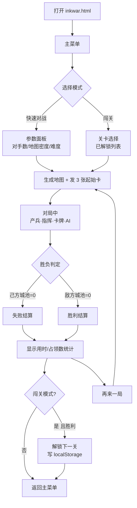
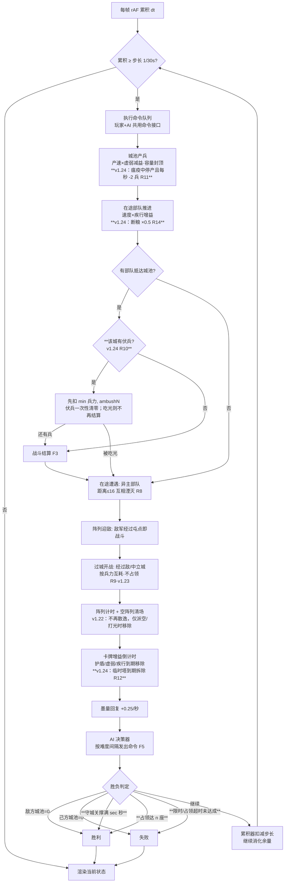
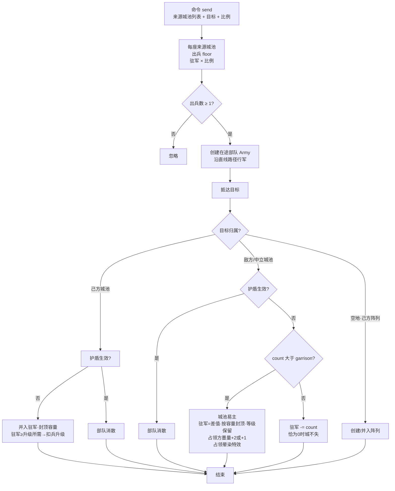
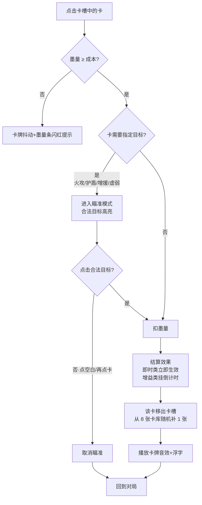
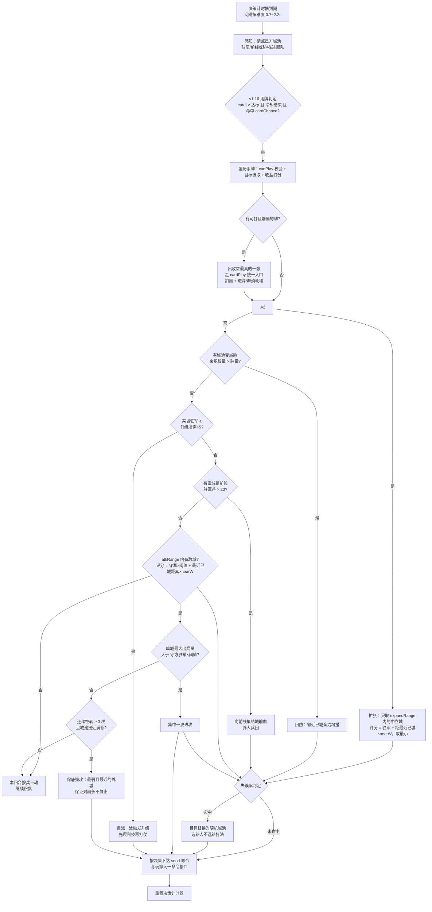

# 墨战（project8）需求文档

> 水墨风 State.io 类 RTS 城池攻防 + 战术卡牌 · 纯前端单机版
> 版本 v1.0 · 2026-10-06 · 配套：[架构设计](./架构设计.md) · [可视化原型](./prototype.html)

---

## 1. 项目概述

### 1.1 背景

墨战是一款水墨风格的 2D 城池攻防策略游戏，核心玩法与《State.io》同源：以颜色（墨色）为代表阵营，开局拥有一座城池，城池自动产兵，通过派兵攻占其余城池扩大产兵网络，最终占领全部敌方城池取胜。墨战的差异化在于**卡牌策略层**（火攻、护盾、借刀杀人等战术卡）与**水墨世界观**（墨色相溶、宣纸、印章、楷体）。

### 1.2 本期目标

| 项 | 内容 |
|---|---|
| 平台 | 浏览器（桌面 + 移动端），纯前端零依赖单文件 HTML，双击即玩 |
| 模式 | 快速对战（1v1 / 1v2 / 1v3 AI）+ 闯关（10 关递进解锁） |
| 单局时长 | 3~5 分钟 |
| 核心体验 | 「框选—派遣—扩张」的微操快感 + 卡牌临门一脚的博弈感 + 水墨视觉氛围 |
| 明确不做（远期规划） | 日卡养成 / 抽卡商城、在途部队互战、动态地形（河流改道等）、皮肤系统（**联机对战已交付：v1.26 联机重做、v1.39 房间码**） |

### 1.3 用户与场景

- 碎片时间玩家：手机竖屏/横屏、桌面浏览器，随时开一局。
- 策略玩家：通过屯兵列阵、卡牌组合实现以弱胜强。

---

## 2. 玩法需求

### 2.1 核心规则

| 编号 | 规则 |
|---|---|
| R1 | 地图由 8~14 座城池构成，分为：己方 1 座、每名 AI 1 座、其余中立（墨灰色） |
| R2 | **被占领的城池**随时间自动产兵，产速与容量由等级决定（见 2.4 数值表）；**中立城不产兵**，驻军固定（v1.4） |
| R3 | 派兵攻击敌方/中立城池：驻军与来犯部队互耗；**来犯兵力 > 驻军时城池易主**，剩余兵力成为新城防，等级保留 |
| R4 | 派兵至己方城池为增援：直接并入驻军；若驻军 ≥ 升级所需，**自动扣兵升级**（Lv3 封顶），溢出部分保留至容量上限 |
| R5 | 胜利：地图上不存在敌方城池（中立城不强制）；失败：己方城池数归零（在途部队不延续寿命） |
| R6 | 屯兵列阵：框选己方城池后点击**空地**，所选部队出城在该点列阵待命；阵列可被再次框选派遣；**屯兵永久驻守，不再散逸**（v1.22 移除原「每 5 秒散逸 1 兵」规则；屯点只在兵被派光或被敌军打光时消失） |
| R7 | 阵列与城池不发生战斗交互（位置公开，风险自负——蓄兵是双刃剑） |
| R8 | **在途互战（墨色相溶）**：不同阵营的在途部队行军途中相遇（距离 ≤ 16 虚拟像素）即互相湮灭，双方按较小兵力扣减，全灭一方消失；胜出部队继续向原目标行军 |
| R9 | **过城开战（v1.23）· 守军清空即接管（v1.36）**：在途部队行军途中经过**敌方 / 中立**城池即自动开战——双方按较小兵力互耗（`min(部队兵力, 城池驻军)`）；**互耗后守军被清空（或本就是空城）即顺手接管**，走与抵达完全相同的 `occupyCastle`；守军还在则只是擦过（拿下有兵的城仍需明说「打这座城」，R3 不变）。己方城不拦截；护盾中的城免疫并给出提示；**当前目标城交给抵达结算**，同一次行军不被结算两次。v1.35 及以前「只互耗、永不占领」，表现为「守军被我打光了城还挂敌旗」 |
| R10 | **伏兵（v1.24）**：「伏击」给**己方城池**设伏（`ambushT` 12 秒 / `ambushN` 杀伤数）。异主部队**抵达**该城时，先被伏兵吃掉 `min(兵力, ambushN)`；若被吃光则不再结算抵达。**伏兵一次性**——触发即清零；护盾分支先于伏兵返回（开盾的城不吃伏兵） |
| R11 | **瘟疫（v1.24）**：「瘟疫」给**敌方城池**上 `plagueT`（8 / 12 秒）。期间该城**停产**且每秒流失 `PLAGUE_RATE`（2）兵；到期自动恢复。与「虚弱」（产速减半）区分开——虚弱只是变慢，瘟疫是净减员 |
| R12 | **临时塔（v1.24）**：「连弩」给**己方城池**架一座 2 级箭塔，`tempT` 秒（12 / 18）后**自动拆除**；已有塔的城不再架设（不覆盖玩家的永久塔）。塔的开火/图标/冷却完全复用既有塔逻辑 |
| R13 | **摧塔（v1.24）**：「摧塔」把**敌方城池**的塔降 `v` 级（1 / 2），降到 0 级即摧毁（`tower = null`）。无塔的城打出无效（目标仍合法，只是无事发生） |
| R14 | **断粮（v1.24）**：「断粮」给**除自己外所有阵营**上 `effects.slowT`（8 / 12 秒），行军速度 × `SLOW_MUL`（0.5）。与「疾行」（己方 ×2）对称，是唯一的**群体减速**手段 |
| R15 | **伤亡记账（v1.25）**：`sim.stats.loss[阵营]` 纯累加，覆盖抵达互耗、在途遭遇、阵列迎敌、过城开战、塔火（含溅射）、火攻、箭雨、伏兵、瘟疫九类减员。**不消耗任何随机源、不参与任何判定**——只喂给战报与生涯统计；双方互耗的场合两边各记一份（语义天然对称） |
| R16 | **难度四档（v1.25）**：`DIFF` 在既有 `easy/normal/hard` 之上新增 `master`（宗师）。**既有三档数值一字不动**（否则全部平衡断言漂移），UI 只做中文标签映射（休闲/标准/困难/宗师）。四档参数单调：决策间隔↓、失误率↓、`minPool`↓、`cardChance`↑、`cardLv`↑、`nearW`↑；宗师 `cardLv=3` 放开全卡池 |
| R17 | **自定义对局参数（v1.25）**：`opts.custom = { inkStart, capMul, prodMul }` + `goal:{type:'time', sec}`。**不传 custom 时与 v1.24 逐字节等价**；`capMul/prodMul` 直接乘进已有的 `sim.mods`（不新增字段）。限时到点按「占城数 → 其次总兵力」判胜，多者胜，完全相同判玩家负（鼓励主动出击） |
| R18 | **新手引导（v1.25）**：首次进入自动起九步分步引导；每步「四面遮罩挖洞」高亮一个真实 UI 元素并讲解；可**跳过**，进度写 `ink.tut`，未完成时菜单给「继续引导（第 n 步）」**断点续接**；引导与 `mode` 正交（不改写任何既有状态）；`wait` 步骤 90 秒未等到自动过，防卡死 |
| R19 | **战报（v1.25）**：对局结束产出战报——双方兵力曲线（0.5 秒一采样，上限 600 点）、关键事件时间轴（按重要度取前 12 条，同类 3 秒节流）、用时与双方折损/占领/用卡统计。**只留内存不落盘**（零配额占用），结算页「查看战报」进入，战报页提供**再战此局 / 返回菜单** |
| R20 | **三槽位存档（v1.25）**：三个档位读写删，存**元进度**（进度、最快纪录、战绩、卡组、收集、生涯、成就、设置）+ **最近一局种子**，「一键复现同一开局」。**不存棋盘中局**——`sim` 含三路随机源函数与互相引用，JSON 化不可靠；「种子 + 配置」才是可复现的最小充分条件 |
| R21 | **成就（v1.25）**：12 条成就，含解锁条件与进度展示；未解锁项名字隐藏为「？？？」并显示 `x / y`。数据源是 `ink.life` 生涯统计（块2 自算，不动块1）；**联机与教学局不计入生涯**，避免刷成就 |
| R22 | **教学局（v1.25）**：引导末步开一局真实快速对战（`opts.tutorial = true`），照常给战利品，但**不计入战绩 / 闯关进度 / 最快纪录 / 生涯统计** |
| R23 | **快照同步补齐（v1.26）**：快照新增 `fx`（断粮 slowT）/ `pt`（屯田 prodT）两个效果数组，城池行**尾部追加** `ambushT / ambushN / plagueT / 塔临时剩余` 四个字段（尾部追加 = 新旧版本可互解）。根因：客机航位推算走 `Sim.armySpeed`，它要读 `slowT`；缺了它断粮期间客机按原速推算，位置持续超前再被快照硬拉回 = 肉眼可见抖动 |
| R24 | **短联机码（v1.26）**：联机码三步无损瘦身 —— ① `sdpMin` 按白名单裁掉数据通道用不到的行（extmap / ice-options 等）；② 令牌表把 `a=candidate:` 等高频前缀与候选行固定短语换成单字符（**只作用在 SDP 上**，避免与 JSON 自己的 `{}` 撞车）；③ base64url（去填充、URL 安全，链接里无需转义）。浏览器支持 `CompressionStream('deflate-raw')` 时再压一层。码首字符区分版本：`z`=压缩码 / `s`=裁剪码 / 其余=旧版整份 base64（**向后兼容仍可解**）。实测缩短 37%（裁剪）~ 60%（压缩） |
| R25 | **连接过程可视化（v1.26）**：`#pvpStat` 跟随 ICE 阶段实时播报（建立 / 协商 / 已连接 / 中断 / 失败），**20 秒未连通明确报超时**并给出可操作建议（换同一 Wi-Fi 或手机热点）；`failed` / `closed` 立刻给原因。`disconnected` 多为瞬时抖动，**交给心跳宽限处理**，不直接判死 |
| R26 | **心跳与断线宽限（v1.26）**：每秒一次 `pg`/`po` 测往返延迟（顶栏实时显示，≤80ms 绿 / ≤200ms 金 / 更高朱砂）；`DataChannel.onclose` 在异常网络下可能长时间不触发，故 **连续 4 秒无下行包即判定失联** → 暂停对局 + **10 秒重连宽限**（主机不能趁对手掉线单方面推进），重连即续、超时走终止流程 |
| R27 | **房主配置与客机暂停（v1.26）**：等待室可设**地图 / 节奏 / 限时**并随 `cfg` 消息实时同步给客机（客机只读）。**PVP 双方都是人、没有 AI，难度选项没有意义，故不提供**。客机可发 `pausereq` **请求暂停**——决定权仍在房主（避免客机单方面冻结对局），20 秒无响应给提示 |
| R28 | **再战双向确认与战绩口径（v1.26）**：再战改为**双向确认**——任一方点「再来一局」只登记意愿，双方都点头才由房主发车（此前客机一按就把主机拽进新局）；20 秒无人响应提示可先返回菜单。**联机战绩独立记账**（`ink.netrec`）：单机走 `record` + `life`，联机只走 `netRec`，结算页展示「联机战绩」，口径统一、互不污染 |
| R29 | **双指缩放与平移（v1.27）**：双指张开 / 捏合缩放战场（1~3.2×），双指拖动平移视野；桌面滚轮以光标为锚点缩放。**缩放平移只走双指**，单指的点选 / 派遣 / 框选语义一字不改，两条链路永不打架。第二指落下即撤销单指正在进行的拖拽 / 框选，`pointercancel` 与抬指都必须清空触点 |
| R30 | **竖屏布局与视野补偿（v1.27）**：手机竖屏画布比例由 16:9 放宽到 **1.35**，基准 fit 由 contain（留黑边）改为 **cover（铺满）**，棋盘占屏高 25% → 33~40%（8 档机型实测）。铺满必然裁掉两侧，故**视野偏离默认时左下角自动浮出缩略图**（全图城池点 + 朱砂视口框），左上角 **⤢** 徽标一键复位（快捷键 `0`），开新局自动复位 |
| R31 | **入门难度档（v1.27）**：`DIFF` 新增 `novice`（既有的 easy/normal/hard/master **一字不动**），取向不是「打得更慢」而是「**敢打但打不准、也守不住**」——出兵门槛极低（minPool 5 / buffer 0.5）保证家里不留厚壳，六成决策选错目标、完全不用牌、不拦截。实测第 1 关弱玩家胜率 48% → 64%，我方被占城数 3.5 → 2.2 |
| R32 | **十五关梯度抹平（v1.27）**：重排为「入门 ×2 → 休闲 ×4 → 标准 ×4 → 困难 ×5」，敌方初始加成改 0/5/10/15/20 五档细步；**相邻关卡最多「敌数 +1 / 难度 +1 档 / 加成 +5」**，消掉原先「第 6 关 0→10」「第 9 关休闲→困难 + 敌数 2→3」两处跳崖；第 4 关不再「敌数 +1」与「城池 +1」同时发生，第 7 关限时 180 → 240 秒 |
| R33 | **触屏操控放大（v1.28）**：点按/拖动阈值与命中容差全部改按 **CSS 像素**标定（`mapPerCss()` 随缩放换算），粗指针（手指）容差再放大——兵级命中 11 CSS px、部队/阵列 9 CSS px、点按 vs 拖动判定位移 22 CSS px（手机竖屏旧值仅相当于 5~7 CSS px，表现为「点不中兵、轻抖就误出兵」）；**胖手指补偿**：触屏点按按「落指」位置判定意图（按下到抬起常见 10~20px 滑动，按抬起点命中会落空）；屏内方向键按钮粗指针下放大到 44px（≥最小触控热区）；桌面（鼠标）阈值语义不变，打桩断言逐位不漂 |
| R34 | **方向键从「城池」直接起步（v1.29）**：选中**己方城池 / 阵列**后按 `WASD` 或屏内方向键 = **直接派兵朝该方向行军并接管**（此前 `manualLaunch` 只认「点中的兵」，选中城池按方向键只弹提示 + 一声错误音；而电脑上一个环兵的命中直径仅约 7 CSS px，手机端屏内方向键在选中城池时**根本不显示**）；**屏内方向键在选中己方城池/阵列时即浮出**（选中敌方城池仍不浮出）；**什么都没选中时**按方向键自动接管**最近的己方在途部队**（此前同样是死路）。实测：起步延迟 32 ms、改向 32~64 ms、松开 0 ms，选中城池按 W → 48 ms 接管、16 ms 后开始移动 |

| R36 | **连续指令（v1.31）**：单兵 / 部队操控链路里，**移动 → 驻扎 → 再移动**不必重新点选。三处改动：① `dispatch(sources, target, keep)` 新增 `keep` 参数，操控链路（manualLaunch / manualTick）传 `true` **不清空选择**，普通派遣（点目标 / 回防 / 点空地列阵）仍一律清空；② 认领新部队时 `selection = [{k:'a', id}]`（退出驻扎 = 选中在途部队）；③ 松手驻扎时置 `ctrl.settle`，部队抵达消失后 `manualSettle()` 按最后位置认领新扎下的阵列并设为 `selection = [{k:'p', id}]`（**进入驻扎 = 选中阵列**）。部队若被歼灭（`settle = false`）一律不接管，避免误选旁边的阵列。连测三轮「驻扎 → 直接按键」全部成立；真机实测选中城池 → 按 W → 松手驻扎 → 不点任何东西直接按 ↑ 即继续行军 |
| R35 | **物理方向键 ↑↓←→（v1.30）**：方向键此前**完全没有事件分支**——`onKeyDown` / `onKeyUp` 只认 `e.code` 里的 `KeyW/A/S/D`，键盘上那四个键按下去既不派兵也不改向，只留浏览器默认的「滚动页面」（屏内 `.dpad` 有十字键，物理键盘却缺这一半）。新增 `dirOf(e)` 把按键归一化成 `w/a/s/d`：**优先 `e.code`**（物理键位，不受输入法 / 大小写 / 键盘布局影响）→ **`e.key`**（`ArrowUp` 等；虚拟键盘 / 老浏览器可能只有它，大小写不敏感）→ **`e.keyCode`**（38/40/37/39 与 87/83/65/68，兜底）。↑↓←→ 与 `WASD` **完全等价**（按住持续行军、松手就地驻扎，与屏内十字键共用同一条 `manualStart()` 链路）；方向键默认滚动 `preventDefault` 掉；输入法组字中（`isComposing` / `keyCode === 229`）不抢键；焦点在 `INPUT` / `TEXTAREA` / `SELECT` / `contentEditable` 时不劫持（原有守卫保留并补齐）。CDP 真实按键实测 14/14 全绿 |
| R37 | **防御塔索敌补全（v1.32）**：塔的攻击目标集合必须同时包含 `sim.armies`（在途部队）与 `sim.camps`（已驻扎阵列），统一过滤 `count < 1 / owner === 城主 / 距离 > 射程` 后取最近目标。旧实现只遍历 `sim.armies`，所以敌军抵达空地转成阵列后四种塔全部停止开火；这就是「部分炮塔不攻击」的根因。炮塔溅射、爪子抓兵、冷却、伤亡记账与事件表现对两类目标使用同一结算函数 |
| R38 | **士兵进城升级（v1.32）**：己方非满级城在驻军最外环之外显示可点 `↑` 徽章；玩家可点中城内驻军后点击徽章或按 `E`，也可直接点徽章。Lv1→Lv2 消耗 20 兵，Lv2→Lv3 消耗 50 兵，Lv3 封顶；升级后切换到新等级的容量/产速（基础 35/0.7 → 70/1.2 → 110/1.8，容量再乘当前 `mods.cap`）。兵力不足时显示还差几兵且状态不变；满级不再显示徽章，按 `E` 明确提示封顶。升级走 `castleUp` 命令在固定步首结算；客机只能请求，房主强制按 owner=2 校验并随权威快照同步 level/garrison |

| 编号 | 操作 | 行为 |
|---|---|---|
| O1 | 点击己方城池 | 选中（可叠加多选）；点击已选中城池取消 |
| O2 | 按下拖动 | 框选：与矩形相交的所有己方城池/己方阵列加入选择 |
| O3 | 选中后点击敌方/中立城池 | 以当前出兵比例（0~100% 连续，默认 100%，见 O8）从每座选中城池出兵进攻 |
| O4 | 选中后点击己方城池 | 增援（同 O3 规则并入驻军、可触发升级） |
| O5 | 选中后点击空地 | 出兵列阵（R6） |
| O6 | 点击比例按钮 | 切换派遣比例 50% ↔ 100%（默认 100%） |
| O7 | **拖拽卡牌 → 在目标城池松手（v1.33 主入口）** | 需目标的卡（`target` 非 null）必须落到**合法城池**上才发动；无目标卡**拖出手牌区即发动**。拖拽中原卡置灰占位、指针跟随一个**替身**（合法落点朱砂描边高亮 / 非法落点去色变灰），棋盘上合法目标城池复用瞄牌态的**脉动朱砂环**，光标下那座城再加一道实环（合法朱砂 / 非法朱红）。松手在非法处 / 拖回手牌区 / 按 `Esc` = **回弹取消**（替身飞回原位） |
| O7b | 点击卡牌 → 点击目标城池 | 与拖拽**等价**的老入口，一字保留；再点同卡 / `Esc` / 点棋盘空白取消瞄牌 |
| O7c | 卡面精简（v1.33） | 手牌卡面只显示**插画 + 名称 + 费用角标**（另保留稀有度框线/角标、升级「＋」、冷却圆徽、消耗斜切）；描述、冷却秒数、消耗文本一律不出现在卡面 |
| O7d | 详情浮层（v1.33） | 桌面**悬停** / 触屏**长按 300ms** 弹出：卡名、稀有度、费用、冷却秒数、目标类型（由 `card.target` 派生）、描述、消耗提示。浮层 `position:fixed` + 默认 `display:none`（不占布局、不产生溢出），相对卡牌槽位定位。**命中必须与卡面一一对应（v1.33a）**：悬停 / 长按按每张卡的真实 `getBoundingClientRect` 判槽，点（或悬停）任意一张卡只显示该卡自己的标题、费用与描述；因 `.card` 有 `max-width:96px` 且卡面居中聚拢，禁止用「容器五等分」作为主命中口径（仅作打桩回退） |
| O7e | 快捷键 `1`~`5`（v1.33） | 与拖拽 / 点击**同一入口**（`onCardClick` → `playCard`），保留为等价通道（也是打桩环境下出牌回归的唯一通路） |
| O8 | **出兵比例条（v1.34）** | 卡栏左侧的比例选择由「50% / 100%」两颗按钮重构为：**滑块 0~100% 连续调节**（`step 1`）+ **25 / 50 / 75 / 100% 快捷档位** + 实时读数「**百分比 — 实际兵力**」（如 `50% — 3,200 兵`，千分位分隔）。读数与块1 结算**同口径**（逐来源 `floor(驻军 × 比例)` 累加，在途部队与单兵不计），**读数即实派**；拖动即时更新，选中的城池上方跟随显示当前百分比。**可用兵力为 0（未选中己方城池 / 选中来源驻军为空）或比例越界 → 整条置灰（`.off`）并禁用交互**，读数写明「无可用兵力」；越界值钳进 [0,1]，下达军令时再钳一次。默认 100%（沿用旧「全押」手感）。布局：桌面三行竖排；手机竖屏「读数行 +（滑块 + 档位）行」；**横屏侧栏（180px）收成「读数 + 滑块」单行**，档位行让位（实测 8 档机型竖屏棋盘占高零损耗、触控热区全达标） |
| O8.1 | **版本号标记（v1.35）** | 主菜单底栏（`mfoot`）右侧渲染当前版本号（如 `v1.35`），半透明小字、不抢视觉、不改变底栏布局。块2 内 `APP_VER` 为**唯一来源**（全文件只允许一处定义），`window.__ink.ver()` 暴露给自动化核对。**动机**：此前版本只写在注释与文档里，线上页面无法自查，发布后无法确认跑的是哪一版 |
| O8 | 空格 / 按钮 | 暂停 / 继续 |
| O9 | 触屏 | 与鼠标等价：单指拖=框选，点按=选择/派遣；控件热区 ≥ 44px。**v1.37 补充**：① 断点一律带 `orientation`（`≤700px and portrait` / `≤430px and portrait` / `≤950px and landscape`），避免手机横屏同时命中两套规则；② 触屏手牌高度必须用 `.cardbar .card` 这类**更高特异性**写 —— 裸 `.card` 会被源码里排在后面的 `@media (pointer:coarse){.card{min-height:44px}}` 覆盖，实测触屏手牌比桌面还矮；③ 窄屏正文字号不小于 12.5px（提示）/ 11.5px（牌堆），高 DPR 手机上 11.5px 以下实测看不清 |
| O10 | 点击/框选**在途部队**（v1.2） | 选中己方行军中的字兵方阵（金色虚线环=碰撞体积）；选中后点击新城池/空地即**军令改向**；拖拽部队可快速改道；点空地=改道列阵 |
| O11 | 观察部队（v1.2） | 部队以「兵」字方阵建模：**有多少兵显示多少字**，字号/列队/碰撞体积随兵力缩放；攻城时推进+挥砍，遭遇时突刺；行军/战斗全程可见 |
| O12 | 观察城池（v1.3） | 驻军以「兵」字**环绕城池**显示（数量=驻军数，环形受容量封顶，整体慢旋）；城池等级一/二/三级大小 24/34/44；中心数字 + `/人口上限`;阵列兵派走/被敌军打光后「屯」图消失 |
| O13 | 兵级指挥（v1.6/v1.9） | **每一个兵都有独立运动**（相位/步频/摆动各异，神速/攻击时步频加快）；**任何情况下单击任意一个兵都可单独选中**——驻城环字兵、阵列散布兵、在途方阵兵均可；选中后点击目标，该兵**单独出队**执行任务（驻城/阵列兵出 1 兵，在途兵拆 1 兵改道，原队不动），可继续点选其他兵分别指挥 |
| O14 | 全军出击（v1.6） | 残局（中立清空且敌方仅剩一座城）时顶栏出现朱砂按钮：一键全军满额出兵 + 在途部队齐转 + 行军加速 8 秒；联机双方均可用 |
| O15 | 扎营迎敌（v1.6/v1.8） | 阵列不再是安全区——敌军经过扎营处即战斗，双方按兵力互相消耗，阵列可被突破消失；阵列渲染为**全量字兵散布**（多少兵显示多少字，个体微动），不再用「屯N」图省略 |
| O16 | 行军节奏（v1.6） | 行军速度 120→90；新卡「神速行军」★/★★/★★★ 三档（+30%/+60%/+100%，8 秒），低星不覆盖高星 |
| O16a | **WASD 操控单个兵（v1.15）** | 选中某个兵后**按住 `W`/`A`/`S`/`D`** 即朝该方向持续行军（松开就地驻扎）；未选中兵时按下给出「先点中一个兵」提示；被操控的兵脚下有朱砂虚线环 |
| O16b | **鼠标点击 = 攻击（v1.15）** | 选中某个兵后，**鼠标点击目标即攻击**：点敌方/中立城池 = 单兵冲锋攻城，点**敌军部队/敌兵** = 冲上去与敌互溶（墨色相溶），点空地 = 走过去驻扎，点己方城 = 回城 |
| O16c | **全军 WASD 接管与回防（v1.18）** | 框选**整支在途部队**后按住 `W`/`A`/`S`/`D` 直接操控全军行军（松手就地列阵），不必逐兵点选；选中军队时**点击己方城池 = 回防**（改向该城、抵达并入驻军），不再触发「切换选中这座城」 |
| O16d | **任意城外部队都能回城（v1.36）** | 选中**城外阵列（屯兵）/ 阵列里的兵 / 在途部队 / 在途的单个兵**后点击己方城池，一律下达回城军令：阵列与单兵走 `send`/`split` 出兵，在途部队走 `retarget` 改向，抵达后并入驻军（受容量封顶，并按 v1.32 规则自动升级）。**判定必须排在「点兵」之前**——原来城边/城上有兵时点城只会被兵抢走。只选中城（或城+城）时点它自己仍是「切换选中」，不会自己给自己派兵；城内兵点他所在的那座城 = 忽略 |
| O17 | 快捷键（v1.10 / v1.15 改版 / v1.30 补方向键 / v1.32 补升级） | `1`~`5` 发动对应卡槽（与点击同一入口）；`Q` 一键全选己方城池（**v1.15 起由 `A` 改为 `Q`**，`A` 让位给单兵左移）；`E` 让当前选中的己方城池 / 城内驻军进入主动升级；`空格` 暂停 / 继续；`Esc` 取消瞄牌 / 暂停（再按一次继续）；`0` 视野复位。**方向键 ↑↓←→ 与 `W/A/S/D` 完全等价（v1.30）**。输入框（联机码）聚焦时不劫持按键 |
| O18 | 玩法说明（v1.10） | 主菜单「? 玩法」与暂停面板「玩法说明」打开同一帮助面板：目标 / 操作 / 快捷键 / 五条胜负要诀，返回按钮回到来源界面 |
| O35 | 单兵操控 · WASD（v1.15） | 选中某个兵后按住 `W`/`A`/`S`/`D` 让它**独立行走**：首次按下时被点中的那个兵从原队/驻城环/方阵**就地出队**（沿用其相位 = 同一个兵），随后按方向持续改向前方 160 像素；**松开即驻扎**（就地转为 1 兵阵列）；被操控的兵画朱砂虚线环 |
| O36 | 鼠标攻击（v1.15） | 选中兵后**鼠标左键点谁打谁**：点敌城/中立城 = 单兵冲锋，点敌军部队（含其中的单个敌兵）= 冲向其当前位置互相湮灭；指针悬停敌方目标时红圈高亮。键盘不设攻击键，攻击一律走鼠标 |
| O37 | 全选键迁移（v1.15） | 「全选己方城池」由 `A` 改为 `Q`，帮助面板与提示同步；`A` 在单兵操控语境下恒为左移 |
| O38 | **AI 也会用牌（v1.16）** | AI 不再绕过牌库直接施放固定三张，而是**与玩家共用同一套牌库循环**：每个参战阵营（1~4）各有抽牌堆/手牌/弃牌堆/消耗堆，同样每 6 秒抽 1 张、手牌上限 5；出牌一律走 `cardPlay(sim, slot, target, owner)`（扣墨、进弃牌堆或消耗堆、产生 `card` 事件），**不作弊、不凭空变牌** |
| O39 | AI 用牌的难度分层（v1.16/v1.18） | `easy` 不用牌；`normal` 只用「低风险」类（火攻/虚弱/增援/墨涌/疾行/神速 + v1.18 的征兵/疾驰/勤王）；`hard` 解锁全部 18 类（含护盾、固守、策反、借刀、围魏救赵、箭雨、屯田）。出牌受**墨量** `canPlay` 校验、**同名卡冷却**与**全局冷却** `aiCardCd` 三重约束，按难度 `cardChance` 概率出手 |
| O40 | AI 选牌策略（v1.16） | 每回合对手牌逐张评估「能否打 + 目标是谁 + 收益分」，取收益最高的一张：救城类（固守/护盾/增援）打受威胁最重的己城；削弱类（火攻/虚弱/策反）打**就近**的厚敌城；增益类（墨涌/疾行/神速）在己方有兵在途或准备进攻时使用；借刀/围魏救赵按各自目标规则自动选取 |
| O41 | **就近扩张（v1.16）** | 扩张评分由「只看驻军」改为 **`驻军 + 距最近己方城 × 难度权重`**，并设**远征闸门**：优先只取 `expandRange` 内的中立城，家门口吃干净了才允许远征——AI 不再放着旁边的中立城不占、跨半张地图去打人 |
| O42 | **进攻就近（v1.16）** | 进攻目标同样按 `守军×阈值 + 距最近己方城×权重` 打分，且默认只在 `atkRange` 内选敌城；超出射程的敌国**不主动远征**（仅在没有中立城可占且满仓时由保底强攻打最弱者）。保底强攻同样取「最弱且最近」 |
| O19 | 单兵身份（v1.11） | **点中哪个兵就由哪个兵出发**：驻城环兵 / 方阵兵 / 在途兵均从被点中那个兵的**实际站位**离队（`ref.pt` / `cmd.pt`），并沿用其个体相位 `ph0`（步频与摆动一致）；整队派遣仍从城池/阵列中心出发，行为不变 |
| O20 | 容量可见（v1.11） | 城池外圈容量环按「驻军 / 容量」填充；满仓（≥100%）环转朱砂并在环外标「满」，`/cap` 数字同步标红；容量取 `LEVELS.cap × mods.cap`（铁壁 ×1.2） |
| O21 | 屯兵方阵（v1.11） | 阵列字兵按**行列成方**排布（`cols = ⌈√n⌉`，间距收在阵列半径内），外框画出阵型虚线框，选中时方阵框高亮；渲染 / 点选 / 单兵出队共用 `campFormations()` 同一公式 |
| O22 | 每兵攻击动作（v1.12） | 交战时**每个兵各自突刺 + 各画一道挥砍弧**（不再只由领头兵挥砍）：每个兵有独立攻击相位 `ap` 与个体步频，纯表现层、不改变战斗结算；挥砍弧上限 24 道以控开销。阵列兵`p.atkT`、驻城环兵`c.hitT`同样各自动作 |
| O23 | 城池防御塔（v1.12/v1.18/v1.32） | 开局按概率随机长出**炮塔 / 箭塔 / 法师塔 / 爪子**，**占领后塔随城保留**并为新城主开火；索敌同时扫描射程内的**在途部队与驻扎阵列**，按距离取最近目标（v1.32 修复只扫 `armies` 导致阵列免疫塔火）。城池升级时有几率建塔，已有塔则升一级（上限 Lv3）。塔矢量图标画在城池右上角，下方金点为塔等级，冷却中图标上出现弧线；己方塔常显虚线射程圈 |
| O24 | 等级嵌套环与升级入口（v1.12/v1.32） | 城池圆内**嵌套几层环就是几级**（Lv1 一层 / Lv2 两层 / Lv3 三层），圆半径随等级 24/34/44；外圈金色虚线环为升级进度。己方非满级城在驻军最外环之外绘制半径 17 的 `↑` 徽章：未满足时显示 `↑还差兵数`，满足时转金；渲染与命中共用 `upChipOf()`，临近地图右边界自动翻到左侧 |
| O25 | 势力存亡条（v1.13） | 对局顶栏常驻**势力条**：每个参战阵营一枚「阵营字 + 城池数」徽记，底色为阵营墨色；己方阵营高亮；**阵营城池尽灭 → 徽记灰化并盖红叉**——多方混战一眼看清谁还在、谁最肥 |
| O26 | 城池血条（v1.13） | 每座城池头顶画一条**按 驻军/容量 填充的血条**（与容量环互补）：墨绿 <70% → 金 70~99% → 朱砂 ≥100%；攻城/塔火掉血直观可见 |
| O27 | 联机等待室（v1.13） | 连接建立后不再立即开局，进入**等待室**：双方席位（阵营色 + 准备勾 + 生涯战绩 X胜Y败）+ 房间动态 log（已连接 / 进入 / 准备 / 倒计时）+ 「准备」按钮；双方都准备后 3 秒倒计时开局，任一方可取消返回菜单 |
| O28 | 卡片图鉴（v1.13） | 主菜单卡包面板内新增**图鉴陈列**：5 张日卡与 18 张次卡逐枚列出，**获得过的点亮并带持有数角标**（×n），未获得的灰显——收集进度一眼可读 |
| O29 | 牌库循环（v1.14） | 每位玩家一套**抽牌堆 / 手牌 / 弃牌堆 / 消耗堆**：卡组洗入抽牌堆，开局抽 3 张，**每 6 秒自动抽 1 张**，**手牌上限 5**；抽牌堆空 → 弃牌堆整堆洗回（消耗堆不回）；打出的牌进弃牌堆，标记「消耗」的强力牌进消耗堆本局不再出现 |
| O30 | 手牌五槽（v1.14） | 卡槽 3 → **5**（快捷键 `1`~`5`）；空槽占位灰显，抽到新牌有淡入；墨不足的卡半透明不可点（沿用现有反馈） |
| O31 | 卡面稀有度（v1.14） | 普通 / 罕见 / 稀有三级，卡名与描边配色区分；**只影响战利品出现权重，不影响抽牌概率**。图鉴按稀有度分组陈列 |
| O32 | 消耗堆（v1.14） | 借刀、策反、勤王（v1.18）三张稀有卡打出后**移出本局**（进消耗堆），强度因此可做得更高；消耗堆计数在 HUD 可见 |
| O33 | 卡牌升级版（v1.14） | 18 张次卡各有一张 `+` 强化版（数值见 2.3 表末列），**只通过战利品获得并加入卡组**；卡组内原版与升级版可共存 |
| O34 | 牌组构筑（v1.14） | 结算「三选一」改为**选 1 张卡永久加入 `ink.deck` 卡组**（跨局累积），初始卡组 12 张（v1.18）；日卡改为**每日首次开局随机赠 1 张**；HUD 常显「抽/弃/消」三堆计数，洗牌飘「洗牌」提示 |

### 2.3 卡牌需求（v1.14 牌库循环 · v1.18 扩至 18 张次卡 + 18 张升级版）

墨量：卡牌资源，上限 10，开局 3，**每秒 +0.25**；占领敌城 +2、占领中立 +1（**保留为「能量」，不走回合回满**——实时局没有回合）。

**牌库循环（v1.14，杀戮尖塔式）**：每位玩家一套四堆——**抽牌堆 draw / 手牌 hand / 弃牌堆 discard / 消耗堆 exhaust**。

| 环节 | 规则 |
|---|---|
| 开局 | 本局卡组 `list`（默认 12 张，见 2.6a）洗入抽牌堆，**开局抽 3 张** |
| 抽牌 | 每 **6 秒**自动抽 1 张，**手牌上限 5 张**（满则本次不抽、计时器保持待抽） |
| 洗牌 | 抽牌堆空时，**弃牌堆整堆洗回抽牌堆**（消耗堆不回）——洗牌时飘「洗牌」提示 |
| 出牌 | 打出后进**弃牌堆**；标记「消耗」的强力牌进**消耗堆**（本局不再出现） |
| 抽空 | 抽牌堆与弃牌堆皆空 → 不再抽牌（牌已打光，靠存量打完残局） |
| 冷却 | **同名卡打出后进入冷却（8~40 秒，见下表）**，冷却中同名卡（含升级版）不可发动；卡面实时显示「⏱倒计时」并置灰（v1.18） |

**卡面稀有度**：普通 common / 罕见 uncommon / 稀有 rare，卡名配色区分；**稀有度只影响战利品出现权重，不影响抽牌概率**（抽牌顺序由洗牌决定，与杀戮尖塔一致）。

| 卡名 | 成本 | 冷却 | 目标 | 稀有度 | 消耗 | 效果 | 升级版（+） |
|---|---|---|---|---|---|---|---|
| 征兵 | 2 | 8s | 无 | 普通 | — | 己方所有城池各 +5 兵（v1.18，便宜的铺量牌） | 各 +8 兵 |
| 疾驰 | 2 | 10s | 无 | 普通 | — | 5 秒内己方行军速度 ×2（v1.18，短平快版疾行） | 7 秒 |
| 疾行 | 3 | 15s | 无 | 普通 | — | 10 秒内己方所有在途部队与阵列派遣行军速度 ×2 | 14 秒 |
| 护盾 | 4 | 18s | 己方城 | 普通 | — | 8 秒内目标城免疫外来部队（来犯即消散），持续期间仍正常产兵 | 12 秒 |
| 增援 | 4 | 14s | 己方城 | 普通 | — | 目标城立即 +25 兵（不触发升级判定） | +40 兵 |
| 虚弱 | 4 | 20s | 敌城 | 普通 | — | 10 秒内目标城产速减半 | 14 秒 |
| 神速行军·★ | 3 | 12s | 无 | 普通 | — | 己方行军 +30% 持续 8 秒 | +45% |
| 火攻 | 5 | 30s | 敌/中立城 | 罕见 | — | 烧毁目标 40% 驻军（向下取整） | 烧 60% |
| 箭雨 | 5 | 25s | 无 | 罕见 | — | 敌方**所有在途部队**折损三成（向下取整，v1.18 反快攻牌） | 折损四成半 |
| 屯田 | 5 | 30s | 无 | 罕见 | — | 10 秒内己方**所有城池**产速 ×2（v1.18 阵营级增益） | 14 秒 |
| 围魏救赵 | 5 | 30s | 无 | 罕见 | — | 敌方所有在途部队立即折返，回到各自出发城池（视为敌方增援） | 折返并削 20% 兵 |
| 固守 | 5 | 25s | 己方城 | 罕见 | — | 目标己城产速 ×3 持续 8 秒（与虚弱对偶） | 12 秒 |
| 墨涌 | 6 | 20s | 无 | 罕见 | — | 己方所有城池各 +8 兵 | 各 +12 兵 |
| 神速行军·★★ | 4 | 15s | 无 | 罕见 | — | 己方行军 +60% 持续 8 秒 | +85% |
| 神速行军·★★★ | 5 | 18s | 无 | 罕见 | — | 己方行军 +100% 持续 8 秒；低星不覆盖高星 | +140% |
| 借刀 | 6 | 35s | 无 | 稀有 | **消耗** | 距己方主城最近的 1 座中立城立即倒戈为己方（连同驻军） | 最近 2 座 |
| 策反 | 6 | 30s | 敌城 | 稀有 | **消耗** | 目标敌城 30% 驻军倒戈，化为己方部队就地攻向该城 | 45% |
| 勤王 | 6 | 30s | 己方城 | 稀有 | **消耗** | 目标己城及 **420 距离内**的所有己方城各 +18 兵（v1.18 AOE 增援） | 各 +28 兵 |

**升级版**（杀戮尖塔式）：同名卡的强化变体，卡名带 `+`，数值见上表末列，**只通过战利品获得并加入卡组**（不会凭空出现在初始牌组）；一张卡组里可以同时有原版与升级版。

**增益归属（v1.10）**：疾行 / 神速行军 / 全军出击的加速**只作用于发动方阵营**（内部按 `effects.rushT[owner]` / `starT[owner]` / `starMul[owner]` 记账），联机与多方混战中不会误增益他人。

### 2.4 数值表（代码唯一事实源 `CFG`，本表与代码同步维护）

**城池等级**

| 等级 | 产速（兵/秒） | 容量上限 | 升级消耗（增援抵达时自动扣除） |
|---|---|---|---|
| Lv1 | 0.7 | 35 | → Lv2 需 20 |
| Lv2 | 1.2 | 70 | → Lv3 需 50 |
| Lv3 | 1.8 | 110 | —（封顶） |

**行军与战斗**

| 参数 | 值 |
|---|---|
| 虚拟地图尺寸 | 1600 × 900（渲染时等比缩放） |
| 行军速度 | 120 虚拟像素/秒（疾行 ×2） |
| 在途遭遇判定 | 两军碰撞体积相接即湮灭：armyR = 9 + min(8, √兵力×1.3)（R8） |
| 占领判定 | 来犯 count > 驻军 garrison 才易主；剩余兵力按新城池容量封顶 |
| 中立城初始驻军 | 18~32（随机，**不产兵、固定不变** v1.4） |
| 双方主城初始驻军 | 20（闯关高关卡 AI +10~20） |
| 城池最小间距 | 240 虚拟像素（泊松盘采样保证） |
| 城池半径（按等级） | Lv1 24 / Lv2 34 / Lv3 44 虚拟像素（v1.3） |
| 容量环（v1.11） | 半径 = 城池半径 + 9；按 驻军/容量 比例顺时针填充，满仓转朱砂 + 环外标「满」 |
| 阵列队形（v1.11） | 方阵：`cols = ⌈√n⌉`，间距 `min(13, 2·campR/(cols-1))`，整体收在阵列半径内 |
| 行军速度 | 90 虚拟像素/秒（v1.6 减慢，个体运动可见；疾行 ×2、神速 ★+30%/★★+60%/★★★+100% 可叠加） |
| 阵列迎敌半径 | armyR + 26（敌军经过即战斗，v1.6） |
| 手牌上限（v1.14） | 5 张；开局抽 3 张 |
| 抽牌间隔（v1.14） | 6 秒 / 张（手牌满则本次不抽，计时器保持待抽） |
| 洗牌（v1.14） | 抽牌堆空且弃牌堆非空 → 弃牌堆洗回抽牌堆（Fisher–Yates，走 `sim.drng`） |
| 战利品权重（v1.14） | 普通 1.0 / 罕见 0.55 / 稀有 0.2；升级版概率：胜 25% / 负 10% |
| 人口上限显示 | 城池中心数字下标注 `/cap`（35/70/110），驻军环字受容量封顶（v1.3） |
| 阵列清场 | 阵列兵派走/被敌军打光后「屯」图即消失（v1.22 起不再散逸） |
| 等级嵌套环（v1.12） | 环数 = 等级；第 i 层半径 `castleR × (0.45 + 0.47×(i+1)/level)`（i 从 0 起，内→外，不侵占中央数字区） |
| 升级进度环（v1.12） | 半径 = 城池半径 + 18 的金色虚线环，填充比例 = 驻军 / `LEVELS[level-1].up`；满进度转金并标注「↑可升」，Lv3 不显示 |

**AI 决策参数（v1.16，见 `DIFF`）**

| 难度 | 决策间隔 | 失误率 | ratio | atkRatio | cardLv | cardChance | 出牌冷却 | nearW（距离权重） | expandRange | atkRange |
|---|---|---|---|---|---|---|---|---|---|---|
| 容易 | 2.2s | 0.35 | 0.5 | 1.0 | 0（不用牌） | 0 | — | 0.02 | 无限 | 无限 |
| 普通 | 1.2s | 0.10 | 0.6 | 0.9 | 1（六类低风险牌） | 0.20 | 15~40s | 0.05 | 1000 | 1200 |
| 困难 | 0.7s | 0.03 | 0.65 | 1.0 | 2（全部 13 类） | 0.45 | 15~40s | 0.08 | 800 | 900 |

- `nearW`：**每 1 虚拟像素折算多少「兵力分」**——扩张/进攻评分 = `守军（+阈值加成） + 最近己方城距离 × nearW`，取最小者。
- `expandRange / atkRange`：**远征闸门**。范围内有候选就只在范围内挑；范围内无候选才放宽到全图（防发展锁死）。
- `cardLv`：0 不用牌 / 1 六类低风险（火攻·虚弱·增援·墨涌·疾行·神速）/ 2 全 13 类。
- **出牌冷却按牌分级**（火攻·策反·借刀·围魏救赵·固守 40s，护盾 30s，墨涌 25s，虚弱·增援 20s，疾行·神速 15s）：统一 40s 会导致「打一张弱牌后 40 秒内火攻也放不出来」。
- **留墨门槛** `AI_CARD_KEEP`：弱效牌（虚弱/增援/墨涌/疾行/神速）需 `墨量 ≥ 费用 + 5` 才打，避免把火攻的墨挤掉。
- 困难 AI 的 `ratio / atkRatio` 由 0.8/0.9 调为 **0.65/1.0**（v1.16 实测）：原参数下困难真胜率仅 ~35%，修正判据后重新调参至 **70%**。

**防御塔（v1.12）**

| 塔种 | 射程 | 单发伤害 | 冷却 | 特性 |
|---|---|---|---|---|
| 炮塔（炮） | 210 | 3 | 2.2s | **溅射半径 70**：主目标外，落点 70 内的其他敌军同样减员；弹道走抛物线 |
| 箭塔（箭） | 150 | 1 | 0.6s | 射速最快，单发伤害最低 |
| 法师塔（法） | 170 | 6 | 2.8s | 单发伤害最高，冷却最长 |
| 爪子（爪） | 130 | 0 | 3.5s | 不杀伤：**抓走目标 30% 兵力转为己方驻军**（受城池容量封顶）；**中立城只消耗不转化** |

| 参数 | 值 |
|---|---|
| 开局建塔概率 | 主城 `TOWER_CHANCE.home = 0.5`；中立城 `TOWER_CHANCE.neutral = 0.3` |
| 升级建塔概率 | `TOWER_UP_CHANCE = 0.45`（有塔则升一级，无塔则建 Lv1） |
| 塔等级上限 | `TOWER_MAX_LV = 3` |
| 塔属性成长 | 伤害 `×(1+0.5k)` · 射程 `×(1+0.15k)` · 冷却 `×(1-0.15k)`（k = 塔等级-1） |
| 开火规则 | 冷却就绪时射击射程内**最近**的非己方部队；不攻击己方；命中后目标 `atkT = 0.35`（做出受击动作） |
| 随机源 | 塔掷点走独立 RNG `sim.trng`（由 `seed ^ 0x5f3759df` 派生），**不污染主线随机序列**——开/关塔不改变地图点位、驻军与手牌 |

**墨量与卡牌**

| 参数 | 值 |
|---|---|
| 墨量上限 / 初始 | 10 / 3 |
| 墨量回复 | +0.25/秒 |
| 占领敌城 / 中立 | +2 / +1 |
| 卡槽 | 3 张 |

**AI 难度**（失误 = 目标选错而非无脑送兵；行为优先级：扩张 → 回防 → 升级 → 前线集结 → 进攻 → 满仓保底强攻）

| 难度 | 决策间隔 | 失误率 | 扩张比例 | 进攻比例 | 进攻阈值 | 拦截 | 用卡 | 行为特征 |
|---|---|---|---|---|---|---|---|---|
| 容易 | 2.2s | 35% | 50% | 100%（全力） | 守方驻军 ×0.85 | — | — | 常打错目标 |
| 普通 | 1.2s | 10% | 60% | 90% | 守方驻军 ×0.9 | — | 低频火攻 | 会回防、会升级 |
| 困难 | 0.7s | 3% | 80% | 90% | 守方驻军 ×0.85 | ✓ | 固守/策反/火攻 | 拦截增援、协同进攻、防偷家 |

**AI 决策增强（v1.7）**：守备意识（己方裸奔且敌军在途时隐忍不出兵）· 在途拦截（在途强队改道吃掉敌方增援）· 回防双城增援 · 进攻协同（主攻手 + 400px 内友城各出六成添头，突破单城上限）· 受威胁城不出兵不升级 · 卡牌分层运用（普通低频火攻，困难按战局固守救城/策反厚城/火攻点杀）。

**AI 目标修正（v1.10）**：火攻不再固定打 1 号玩家，改为点杀**当前驻军最厚的敌对阵营**（无敌方城时退化为最厚的非己方城），保证 1v2 / 1v3 混战中火力分配公允。

**v1.10 修正清单**：① 疾行/神速/全军出击加速按阵营记账（原仅作用于 owner 1，客机发动会误增益主机）；② 占领得墨按 `sim.inkMax` 封顶（原写死 `CFG.INK_MAX`，墨海日卡无效）；③ 墨海日卡键名 `inkMax` → `inkMaxDelta`（原键名不匹配，+2 上限从未生效）；④ 占领统计按阵营记录（原仅记 owner 1，PVP 客机结算显示 0）；⑤ 阵列改用自增主键，清场重排不再让选择集/派遣指向错误阵列；⑥ `canPlay` 补齐策反（需敌城）、固守（需己城）的合法性校验，无目标时给出明确原因而非静默失败。

（进攻阈值 = 单城最大出兵量需超过的守方驻军倍率；未达阈值时 AI 继续积累升级。）

### 2.5 系统需求清单

- **对局系统**：地图生成（泊松盘）、固定步长模拟、战斗结算、胜负判定。
- **指挥系统**：点选/框选/派遣/列阵/比例切换（O1~O9）。
- **卡牌系统**：墨量、3 卡槽、摸牌循环、8 张卡效果与目标选择模式。
- **AI 系统**：三档难度，与玩家共用同一命令接口。
- **进度系统**：闯关解锁、最快胜利用时、音效开关、生涯战绩（胜/负/连胜）、**卡包（下局次卡包 / 今日日卡包）**（localStorage，前缀 `ink.`）。
- **受击反馈（v1.4）**：攻城未破时城池红闪抖动；困难 AI 会运用固守/策反/火攻三卡。
- **反馈系统**：WebAudio 合成音效（点选/出兵/占领/卡牌/胜负）、占领晕染特效、浮字提示。
- **响应式系统**：桌面/手机竖屏/手机横屏三套布局，触屏虚拟按钮。
- **联机系统（v1.1）**：好友对战 1v1，WebRTC P2P 直连 + 主机权威状态同步，详见 2.6。

### 2.6a 卡包体系（v1.5 日卡 · v1.14 改版）

| 编号 | 需求 |
|---|---|
| K1 | **掉落**：每局结算固定掉落一次「三选一」战利品；**v1.14 起候选全部为次卡**（见 2.6b D2），按稀有度权重抽取，胜利时有概率给出升级版 |
| K2 | ~~次卡：下局来用~~（**v1.14 起由「加入永久卡组」取代**，见 2.6b） |
| K3 | **日卡**：**v1.14 起改为每日首次进入菜单随机赠 1 张**（不再从战利品掉落），**当日所有对局**自动生效（被动增益），跨天自动清空 |
| K4 | 日卡池（5 张被动）：屯田（产速+15%）、墨泉（墨量回复+50%）、铁壁（容量+20%）、急行（行军+15%）、墨海（墨量上限+2）；日卡不进卡组与抽牌堆 |
| K5 | 菜单卡包面板展示「今日日卡 / 本局卡组」；主菜单与结算页均可查看 |
| K6 | 联机公平性：联机对局中日卡被动不生效（双方一致）；卡组为房主的存档卡组，客机起始手牌由主机抽取后随快照下发 |

### 2.6b 牌组构筑（v1.14，杀戮尖塔式 deck building）

| 编号 | 需求 |
|---|---|
| D1 | **卡组存档**：`ink.deck` 持久化玩家的卡组（卡 key 数组）。初始卡组 12 张（v1.18）：**征兵×2、疾驰×1、增援×2、护盾×2、疾行×1、虚弱×1、火攻×1、神速·★×1、箭雨×1**；跨局累积、跨天保留 |
| D2 | **战利品改版**：结算「三选一」不再是日卡/次卡，而是**从次卡池抽 3 张（不重复）让你选 1 张永久加入卡组**；候选按稀有度权重抽取（普通 1.0 / 罕见 0.55 / 稀有 0.2），**胜利时有 25% 概率候选为升级版**（失败 10%），可「跳过」不取 |
| D3 | **卡组上下限**：卡组无硬上限，但**少于 6 张时补默认牌**（防抽空死局）；卡组内容可在菜单查看 |
| D4 | **日卡改版**：日卡不再从战利品中掉落，改为**每日首次开局随机赠 1 张当日日卡**（5 张之一），当日所有对局生效、跨天清空——养成向保留，且不与卡组构筑抢战利品位 |
| D5 | **AI/联机**：AI 与联机对手一律使用默认卡组（D1 的 12 张），不吃玩家存档，保证公平 |
| D6 | **牌堆可见**：HUD 常显「抽 n / 弃 m / 消 k」三堆计数；洗牌时飘「洗牌」提示并播放音效 |

### 2.6c 单兵操控（v1.15）

| 编号 | 需求 |
|---|---|
| C1 | **接管**：鼠标点中己方任意一个兵（驻城环兵 / 方阵兵 / 在途兵）即接管该兵，被控兵画**朱砂虚线圈 + 金弧 + 「控」字**；再次点同一个兵 = 取消接管 |
| C2 | **持续行走**：按住 `W` / `A` / `S` / `D` 单兵持续朝该方向走——每 0.08s 向前方 **160 像素**处重设一次目标（复用既有改向命令），八向支持，斜向做**归一化**（不比直行快） |
| C3 | **松手驻守**：松开所有方向键 → 目标改回自身位置，就地转为 1 兵阵列（扎营）并解除接管 |
| C4 | **鼠标攻击**：接管后鼠标左键**点谁打谁**——点敌城/中立城即单兵冲锋，点敌军部队（含其中单个敌兵）即冲向其当前位置互相湮灭；点己方目标不响应 |
| C5 | **与其他控制互斥**：接管期间 UI 与 AI 不插手这支部队；键盘不设攻击键（攻击一律走鼠标） |
| C6 | **脱离保护**：接管后若该兵所在部队在认领前已阵亡，0.5s 后自动放弃等待，避免「永久锁定、什么都控不了」的死锁 |
| C7 | **键位迁移**：「全选己方城池」由 `A` 改为 `Q`（`A` 恒为左移），帮助面板与提示语同步 |

### 2.7 AI 对手（v1.16：会用牌 + 就近扩张）

| 编号 | 需求 |
|---|---|
| A1 | **牌库人人有**：参战阵营（1~4，多方混战同样成立）各建一副牌堆，AI 与玩家同规则同卡组（默认 12 张），公平 |
| A2 | **AI 出牌走同一入口**：`cardPlay()` 统一处理扣墨 / 弃牌堆 / 消耗堆 / 事件广播，AI 不享有任何特权路径 |
| A3 | **就近优先**：所有「选目标」的评分都带上**距最近己方城**的距离项，权重随难度递增（越会打的 AI 越重视家门口） |
| A4 | **远征闸门**：中立城取 `expandRange` 内、敌城取 `atkRange` 内；范围内无目标时才放宽，保证不会因「只看近」而锁死发展 |
| A5 | **用牌可见**：AI 出牌同样产生 `card` 事件，玩家侧能看到敌方用了什么牌（与己方出牌同一套飘字反馈） |
| A6 | **不破坏既有强度口径**：困难 vs 容易胜率仍 ≥ 60%、无一僵局（verify-sim 断言） |

### 2.8 移动端响应式布局（v1.17）

| 编号 | 需求 |
|---|---|
| R1 | **遮罩层全屏化**：菜单 / 玩法说明 / 暂停 / 结算 / 战利品 / 等待室一律 `position:fixed` 铺满视口，不再被塞进 16:9 的小舞台里（竖屏手机上舞台仅约 360×202，面板会被压得无法操作） |
| R2 | **安全区适配**：`viewport-fit=cover` + `env(safe-area-inset-*)`，顶栏避让刘海、底部操作区避让 home 条，横屏左右同样留白 |
| R3 | **舞台预留高度实测化**：`--stage-reserve` 由 JS 量取「顶栏 + 卡牌栏 + 间距 + 安全区」后写入，替代硬编码的 176/196/180/132——换机型、换字号都不会算错 |
| R4 | **卡牌栏零横向溢出**：5 张卡改为 flex 等分（`flex:1 1 0` + `min-width:0`），取消与 `max-width` 冲突的 `min-width:88px`；卡名字号 `clamp()` 自适应；320px 窄屏也不出横向滚动条 |
| R5 | **竖屏人机工学**：操作区贴底（拇指热区）而非居中虚掷，地图居中；卡牌加高到 ≥72px，比例按钮 ≥48px。**v1.37 修正**：地图不再「居中虚掷」——舞台 `flex:1 1 auto` + `min-height:0`、画布 `position:absolute` 铺满舞台，把原先均分到棋盘上下的约 300px 死白全部还给棋盘 |
| R6 | **横屏手机**：顶栏压缩为一行极简 HUD、牌堆计数移入顶栏，纵向空间全部让给地图 |
| R7 | **防浏览器手势干扰**：`overscroll-behavior:none`（防下拉刷新/橡皮筋）、按钮 `touch-action:manipulation`（防双击缩放）、chrome 区 `user-select:none` + `-webkit-touch-callout:none`（防长按菜单/选中） |
| R8 | **输入态重排**：联机码输入框聚焦弹出软键盘时，按 `visualViewport` 的可见高度重新布局，避免操作区被键盘顶出屏幕 |

> v1.18 收尾：R3（`--stage-reserve` JS 实测 + ResizeObserver 跟随顶栏/卡栏高度）与 R8（`visualViewport` → `--vvh`，舞台与面板同步重排）已实现并有冒烟断言覆盖。

**v1.37 移动端重做（实测驱动）**

| 编号 | 需求 |
|---|---|
| R13 | **单指拖动地图（v1.38）**：触屏**单指拖空白 = 平移地图**（`viewPanBy`）；框选退到「长按 300ms 后拖」（`PAN_LONG`，与卡牌长按看详情同一套交互语言）；从城 / 兵 / 阵列 / 部队拖出仍是派遣与改向，优先级高于平移。桌面鼠标拖空白仍是框选，语义零回归。双指缩放平移不变 |
| R14 | **手机上棋盘再放大（v1.38）**：竖屏 `--board-ar-min` `.9 → .62`（旧值把舞台卡死在 416px，剩 116px 变死白）；比例条在「无可出兵选中项」时收起（`.cardbar .ratio.off{display:none}`，省 73px）。手机竖屏棋盘占高 **≥55%**（实测 iPhone13 72%）。**复位 / 开局居中己方主城**（`homeCastle`），未裁切时 `viewClamp` 把偏移钳回 0，桌面 16:9 逐像素不变 |
| R15 | **房间码联机（v1.39）**：房主建房拿到 **6 位房间码**（字符表去 I/O/0/1），客机输这 6 位即加入 —— SDP 由云数据库 `rooms` 表自动中转（房主写 offer / 客机回写 answer / 房主 1.2s 轮询，2 分钟上限），**对局数据仍走 WebRTC P2P，延迟不变**。房间码一次性（握手完成 `roomClose` 作废）、半小时自动失效（`room_sweep`）。三条边界：① 只省掉换码，**跨网能否连仍取决于 STUN/TURN**；② 服务端 exact-Origin 校验，**仅线上页面可用**，本地 `file://` 自动退回手动换码；③ SDK 由 CDN **动态** appendChild 加载（不新增 `<script>` 块，块数恒为 2），离线 / 加载失败一律降级到「用联机码手动连接（备用）」，不卡住流程 |
| R9 | **地图显著放大**：手机竖屏棋盘占屏高 ≥45%（8 档机型 CDP 实测；改版前 iPhone13 仅 33%，v1.38 提到 72%）。竖屏舞台 `flex:1 1 auto` + `min-height:0`，画布 `position:absolute;inset:0` 铺满（不再按 `--board-ar` 反推高度），新增 `--board-ar-min` 闸门限制裁切上限；竖屏上下死白各不得超过 90px |
| R10 | **屏内缩放控件**：触屏（`pointer:coarse`）在棋盘右上角显示 **＋ / － / ⤢ 回正** 三键，热区 44×44，与双指手势共用 `viewZoomStep` / `viewFit` 同一套钳制；桌面端不出现。缩略图仅在「视野被放大或被裁切」时绘制 |
| R11 | **联机入口首屏可达**：手机上「创建房间」必须在首屏可见（实测原本位于滚动内容 1641~1901px 处、视口仅 548~824px）。手机竖屏把「好友对战」排到最前；`pvpStatus()` 写入后自动 `scrollIntoView`（邀请码输入框原本落在 1752px 屏外） |
| R12 | **联机四个环节全通**：① 连接建立（ICE 收集等到 `iceGatheringState==='complete'`，上限 8 秒并实时播报；无公网候选时明确提示「全是内网地址 · 跨网大概率连不上」）；② 房间创建与加入（出码/应答码/自动填码）；③ 状态同步（主机权威快照、客机航位推算与软纠正）；④ 断线重连（失联遮罩与断连结算页都给「重新连接」，双方各点一次重新换码即**续上本局**：主机补推快照、客机索要 `resnap`，不重开、不重抽地图）。进入续连**立即撤掉 10 秒宽限倒计时**。以上由 `tools/check-net.js`（双独立无头 Edge + 移动端模拟 390×844 + 触摸，28 项）端到端覆盖 |

### 2.9 军队操控与卡牌平衡（v1.18）

| 编号 | 需求 |
|---|---|
| V1 | **全军接管**：框选/选中**整支在途部队**后按 `W A S D` 直接操控全军行军（复用 0.08s 改向节流），**松手就地列阵**——不必再逐兵点选（单兵操控 v1.15 规则不变，两路并存） |
| V2 | **点城回城**：选中**任意城外部队**（在途部队 / 阵列 / 单兵）时**点击己方城池 = 回城**——部队改向该城、抵达后并入驻军（受容量封顶）；该操作不再触发「切换选中这座城」。**派不出兵时（出兵比例 0% / 来源无兵）必须给明确提示并保留选择**，不得「清空选择却什么都没发生」 |
| V3 | **同名卡冷却**：每张次卡有 8~40 秒冷却（2.3 表），打出后同名卡（含升级版）在冷却中不可发动；`canPlay` 返回「冷却 n 秒」原因，**v1.33 起**卡面只留冷却圆徽 + 置灰，具体秒数与「冷却中 Ns」改在**详情浮层**展示；AI 出牌同样进冷却（防一波甩光手牌） |
| V4 | **卡池扩充**：新增 5 张卡（征兵/疾驰/箭雨/屯田/勤王，数值见 2.3 表）补齐「兵力 / 移速 / 经济 / 反制」四个方向；默认卡组扩到 12 张 |
| V5 | **塔防图标**：四种塔的徽记由文字升级为矢量笔触图标（炮=炮管+炮架、箭=带羽箭矢、法=四芒星、爪=三道爪痕），与塔等级金点、冷却弧、射程圈叠加渲染 |
| V6 | **AI 收编新卡**：征兵/疾驰/勤王列低门槛（难度 1），箭雨/屯田列高门槛（难度 2）；疾驰/箭雨只在「己方/敌方有部队在途」时才值得打；留墨与冷却规则与 v1.16 一致 |

### 2.10 卡面视觉（v1.19）

**范围红线（不得越界）**：本节**只做表现层**——不改玩法、不改存档结构、不新建商店/开包/卡组管理页、不改块1 逻辑层、不改顶栏/按钮/面板/菜单外框。

| 编号 | 需求 |
|---|---|
| O43 | **每卡专属插画**：18 张基础次卡 + 5 张日卡各配一幅水墨意象小图，用**内联 SVG 矢量**（单文件零外部图片，任意分辨率清晰）。统一 `viewBox 0 0 100 60`，禁用 `defs`/渐变/滤镜/`id=`（图鉴 data-URI 背景是独立文档，取不到宿主 `#id`，且逐像素滤镜在每秒重建的卡面上会掉帧），颜色写死 hex |
| O44 | **升级版复用**：`key+'+'` 不单独配图，复用基础卡同一幅 + CSS 叠加朱砂「＋」印记（插画右下角大印 + 卡名后小印） |
| O45 | **稀有度三档**：普通＝墨线 + 纸白底、罕见＝靛蓝内环 + 冷调底、稀有＝金线 + 虚线内封 + 外晕 + 暖金底；三档色与 `Sim.RARITY.color` 同源（有断言互锁） |
| O46 | **宣纸底纹**：`.card::before` 三层极淡 CSS 渐变（双 radial 云斑 + 1px repeating-linear 帘纹），文字层 `z-index:1` 永远压在纸纹与插画之上 |
| O47 | **手牌 vs 选牌**：手牌卡面窄（≤96px、高 64px），插画走 `absolute` **水印**（零高度代价，重排开销近 0，不挤压舞台 `--stage-reserve`）；结算三选一放大为**正式图区**（`--art-loot-h`） |
| O48 | **状态标记不产文本**：消耗牌走 `data-ex` + 墨签朱砂斜切；冷却走 `.cn[data-cd]` + CSS 圆徽（读 `attr(data-cd)`）——**不新增任何可见文本**，既有卡面文本断言自动免疫 |
| O49 | **图鉴配图**：三栏（日卡 / 次卡 / 强化+）每枚 chip 加 `data-art`，由 `injectArtStyle()` 一次性注入 `[data-art]::before` 背景（41 枚 chip 若逐个内联 SVG 会让 innerHTML 暴涨 ~28KB 并打断既有文本断言）。未获得的卡插画去色 |
| O50 | **任何断点都不隐藏插画**：五个响应式断点只允许调 `--art-op` / `--art-loot-h`；紧急降级把 `--art-op` 置 0 即回到 v1.18 观感，HTML/JS 逻辑无需改动 |

### 2.11 单兵操控·去键盘化（v1.20）

**背景（缺陷来源）**：v1.15 起的单兵操控只能靠物理键盘 `WASD`。在两类环境下等于完全不可用——① **内嵌预览面板**（webview 常吞掉键盘事件，鼠标正常、按键无反应）；② **手机触屏**（根本没有键盘）。同时实测出两个真缺陷：`ctrl.pending` 认领竞态会误劫持整支大军；点按分支缺 `hitArmy`，提示写「点中一个兵或一支部队」但点击部队只能选中单个兵。

| 编号 | 需求 |
|---|---|
| O51 | **屏内十字方向键**：`.stage` 内右下角浮出 3×3 小键盘（↑ ← ↓ → + 中心键），**仅在「已选中兵 / 部队 / 正在接管」时显示**（`mode === 'playing'` 且 `ctrl.id \|\| ctrl.pending \|\| selSoldier() \|\| selection` 含 `k:'a'`） |
| O52 | **与键盘完全同构**：按下方向键 = 写 `keys[dir] = true` 后调 `manualLaunch(manualDir())`，走与 `onKeyDown` 完全相同的一条链路；松开/取消/失焦/指针捕获丢失一律清键，语义同 `onKeyUp`（松手即就地驻扎） |
| O53 | **中心键两态**：未接管时显示「全」——把选中项换成整支部队并接管（`takeoverArmy`），解决「点击部队只选中一个兵」；已接管时显示「驻」——清空方向键，下一 tick 按既有规则就地列阵 |
| O54 | **不抢棋盘事件**：方向键是 `.stage` 内与 canvas 平级的 DOM 覆盖层，事件不会冒泡到 canvas；`touch-action:none` + `setPointerCapture`，触屏滑动不会误触发框选 |
| O55 | **修认领竞态**：单兵出队时先快照「按下前己方部队 id 集合」`ctrl.pendKnown`，`manualTick` 的 pending 分支**只认领不在快照中的新部队**；0.5s 内没等到就放弃（保留原有防卡死） |
| O56 | **点按兜底选整支**：pointerup 点按分支在 `hitSoldier → hitCastle → hitCamp` 全部未命中后，补 `hitArmy(v, mySide)` → `selToggle('a', id)`。放在城池/阵列之后，避免部队停在城边时抢掉「点城池」 |
| O57 | **不破坏既有纪律**：不新增以 `card` 开头的 class；卡面仍 `innerHTML` 字符串拼接；块1（纯逻辑层）零改动 |

### 2.12 敌方出牌提示（v1.20）

**背景**：v1.16 起 AI 会用牌，但反馈只有「地图顶部飘一个卡名、1.4 秒、敌方一律黛青」——既看不出**是谁**打的（多方混战时 2/3/4 号全同色），也看不出**打的是谁**，且一闪而过极易漏看。

| 编号 | 需求 |
|---|---|
| O58 | **事件带目标**：`cardPlay` 的 `card` 事件增加 `target` 字段（目标城池 id，无目标牌为 `-1`）。纯数据字段，块1 不因此触碰 DOM |
| O59 | **顶部横幅**：敌方出牌时棋盘顶部居中弹出提示条 `敌方【阵营字】使用「卡名」· 指向你的城池`，持续 2.6s 后淡出；`pointer-events:none` 不挡棋盘操作 |
| O60 | **目标可视化**：有目标的牌——飘字落在**被打城池上方**并叠一圈阵营色扩散环；无目标的全局牌（征兵/屯田/墨涌/借刀/围魏救赵）——飘字仍在地图顶部居中 |
| O61 | **阵营色/阵营字**：一律走 `castleColor(by)[1]` 与 `SIDE_CHAR`（朱/青/赭/绿），替换原先 `by >= 2 ? 黛青 : 朱砂` 的二元判断 |
| O62 | **专属提示音**：敌方出牌用下行滑音 `Sound.foeCard`（620→360Hz），与己方出牌的上扬音 `Sound.card`（880→1320Hz）可**盲听区分** |
| O63 | **己方不弹横幅**：自己出牌已有手牌消失 + 飘字反馈，横幅只给敌方，避免遮挡视线 |

### 2.13 手机端响应式布局（v1.21）

**背景（六项实测缺陷，Edge 设备模拟 375×667 / 390×844 / 360×800 / 320×568 / 844×390 / 768×1024）**：① 竖屏棋盘只占屏高 21~25%，上下各 200px+ 纯空白（iPhone14 空白占 **54%**）；② **手机上操作提示完全不可见**（`≤700px` 与横屏都 `display:none`，实测 0×0）；③ `.hint` 在卡栏内且高度可变，文案变化撑高卡栏 → **棋盘实时跳动**（平板 768 上卡栏 90→194、棋盘位移 53px）；④ 横屏棋盘只占屏宽 45%（384/844），左右各空 230px；⑤ 竖屏卡片 57~71px 宽还隐藏描述行；⑥ 平板 768 卡栏高达 194px。

| 编号 | 需求 |
|---|---|
| O64 | **提示条高度钉死**：`.hint` 固定 `height` + `overflow:hidden`，文案变化不再影响卡栏高度 —— 根治棋盘跳动 |
| O65 | **手机竖屏提示可见**：竖屏断点不再 `display:none`，提示占卡栏第一行（固定 42px / 窄屏 38px） |
| O66 | **竖屏重排**：`justify-content:flex-start` + `.stage{margin:auto}` —— 顶栏贴顶、卡栏贴底、**舞台在两者之间垂直居中**，纵向富余均分到地图上下，不再堆成一块死白 |
| O67 | **竖屏空间还给卡面**：卡片 `min-height` 72→96（窄屏 88），**恢复描述行**，字号加大 |
| O68 | **横屏卡栏改右侧竖排侧栏**：`.cardbar` 在 `(max-width:950px) and (orientation:landscape)` 下 `position:fixed; right; top; bottom; width:180px; flex-direction:column`，脱离文档流不占纵向；`.stage` 宽度让出 192px 且**靠左排**（棋盘由高度封顶时仍可能宽于让出的宽度，居中会压到侧栏）。实测 844×390 棋盘 384×216 → **544×306（+42%）** |
| O69 | **横屏提示可见**：侧栏底部保留一行（16px 钉死 + 单行省略号），原先横屏同样看不到提示 |
| O70 | **预留计算与 CSS 同源**：`measureStageReserve()` 用 `matchMedia('(max-width:950px) and (orientation:landscape)')` 判断侧栏态，**条件字符串与 CSS 断点逐字一致**；侧栏态不计入卡栏高度。惰性初始化（无头打桩加载时可能还没有 matchMedia） |

### 2.14 屯兵不再散逸（v1.22）

**背景**：原规则（R6）是「阵列每 5 秒散逸 1 兵，减到 0 即整点消失」。实测两个问题：① 单兵操控（O16a / O50~O55）松手驻扎 = 1 兵阵列，**约 5 秒后凭空蒸发**——玩家辛苦走位换来的兵白白没了，体验上等同于 bug；② 文档自相矛盾——架构设计不变量 3 写「`Camp.count ≥ 1`（散逸至 **1 为下限，不归零**）」，代码却是减到 0 直接 `filter` 删掉。玩家反馈「阵列里兵在慢慢变少、兵会自己消失」，故移除散逸。

| 编号 | 需求 |
|---|---|
| O71 | **取消散逸**：移除 `CFG.CAMP_DECAY` 与「每 5 秒 -1 兵」的步进逻辑——**屯兵永久驻守**，兵力不随时间流失。单步顺序里的「阵列散逸」环节改为「阵列计时」（只推进 `atkT` 攻击动作计时） |
| O72 | **清场规则保留**：`Camp.count < 1` 仍立即移除——屯点只在**兵被派光**（派遣/回防）或**被路过的敌军消耗殆尽**（3.6 阵列迎敌）时消失，与 O15「阵列可被突破」一致 |
| O73 | **数据结构瘦身**：`Camp` 去掉 `decayAcc` 字段（阵列创建与联机快照解码同步去掉），避免留下永远为 0 的死字段 |
| O74 | **文案同步**：玩法说明「要诀」里的「阵列每 5 秒散逸 1 兵」改为「**屯兵永久驻守**（不再自行散逸）」 |
| O75 | **文档与代码对齐**：架构设计不变量 3 改为「`Camp.count ≥ 1`，为 0 即销毁——只可能因派光/被敌军打光，不再自行散逸」，消除与代码的不一致 |

### 2.15 过城开战（v1.23）

**背景**：原先只有「敌军经过**阵列**即战斗」（O15），部队经过**城池**却完全无视——玩家操控的兵从敌城身上走过去什么都不会发生，等于穿过一片空气；「墨色相溶」的拦路设定在城池这一侧缺了一半。

| 编号 | 需求 |
|---|---|
| O76 | **过城即战**：在途部队（含 AI 派出的、含手动操控的单兵）行军途中进入 `castleR(c) + armyR(a)` 范围且城池 `owner ≠ 部队 owner` → 立即开战，`kill = min(部队兵力, ⌊城池驻军⌋)`，双方各减；推 `clash` 事件（复用既有墨晕特效），城池 `hitT` 置位触发整环抖动 |
| O77 | **守军清空即接管（v1.36 改写）**：过城互耗后若 `⌊驻军⌋ < 1` 且部队仍有兵 → **接管该城**（`occupyCastle(sim, c, a, true)`：改归属 / 进墨 / 记战报 / 剩余兵力转驻军，部队带着剩下的兵继续行军）。**有守军时不占领**（R3 不变：想拿下有兵的城仍要明说），所以「大兵团路过顺手收走满编城」依旧不会发生 |
| O78 | **己方城不拦截**：`owner === 部队 owner` 的城池完全不响应，走位不被自己人卡住（含单兵操控穿城而过） |
| O79 | **护盾免疫 + 目标城不重复结算**：`shieldT > 0` 的城池免疫过城开战（护盾只对「以该城为目标」的来犯生效的语义在此保持一致）；**当前目标城跳过**，仍由抵达结算按 R3 一次结算完毕 |
| O80 | **空城：不开战但接管**：`⌊驻军⌋ = 0` 时**不互耗**（不会每帧刷 `clash` 事件），但兵力门槛为 0 已满足 → 直接接管（含「互耗同归于尽」时守军归零的情形） |
| O81 | **半径同源**：判定用的 `castleR()` 由逻辑块导出（`Sim.castleR`），渲染层改为复用同一函数——过城判定和画出来的城池必须是同一把尺子 |
| O82 | **文案同步**：玩法说明「要诀」写「行军经过敌方/中立城池会自动开战：守军被打光（或本就是空城）就顺手接管；守军还在则只是擦过，想拿下要点名攻打。己方城不拦你，护盾中的城免疫（会给出提示）」 |
| O83 | **不满足时给明确提示（v1.36）**：① 护盾中 → 「护盾未破 · 该城免疫过路部队」；② 兵力不足被守军吃掉 → 「兵力不足 · 过城部队被守军吃掉了」。提示经 `passHint()` 按「**同一支部队对同一座城只发一次**」节流（否则守军未清时每帧一条飘字） |

**平衡实测（A/B，60 局同种子，困难 vs 容易）**：困难 AI 胜率 72% → **63%**（仍 ≥ 60% 验收线），平均对局时长 153s → **142s**，无僵局。方向符合预期：行军成本上升，对进攻方（困难 AI）的削弱略大于防守方。

**v1.36 接管改动的平衡实测（A/B，n=160×2 种子族，困难 vs 容易）**：困难 AI 胜率 **58.1%→75.0%** / **71.7%→81.8%**（+10~17pp），平均时长 139s→134s / 140s→130s，僵局数不变（0 / 1），占领次数 +8%（其中约 20% 来自路过接管）。原因：强方更爱派兵穿行，顺手捡城的收益被放大。**试过「过路接管不给占城墨」想把差值压回去，实测无差异（75.0% / 81.8% 一字未变）**，故保持与抵达同口径。若后续嫌困难太强，该调的是 `DIFF.hard` 参数而不是接管规则。

### 2.16 新卡牌与战场机制（v1.24）

**背景**：卡池停在 18 张已三个版本，中后期卡组构筑的选择空间不足；同时「减益类」只有虚弱（产速减半）一种，缺少**硬控场**与**反塔**手段——玩家面对一座三级炮塔毫无解法，只能堆人。

| 编号 | 需求 |
|---|---|
| O83 | **卡池 18 → 25 张**：新增七张基础卡（各带 `+` 升级版），**只从战利品产出、不进默认卡组** —— AI 与玩家共用同一副默认卡组，保证公平，新卡是玩家跨局累积的奖励 |
| O84 | **伏击（ambush）** · 普通 4 墨 / 冷却 22s / 目标己城：伏兵 12 秒，来犯先损 10（+ 版 16）兵，一次性（R10） |
| O85 | **瘟疫（plague）** · 普通 5 墨 / 冷却 28s / 目标敌城：8（+ 12）秒停产且每秒 -2 兵（R11） |
| O86 | **连弩（repeater）** · 稀有 6 墨 / 冷却 35s / 目标己城：架 2 级临时箭塔 12（+ 18）秒，到期拆除（R12） |
| O87 | **摧塔（breach）** · 稀有 5 墨 / 冷却 30s / 目标敌城：敌城塔降 1（+ 2）级，降到 0 即毁（R13） |
| O88 | **墨锭（forge）** · 普通 1 墨 / 冷却 12s / 无目标：立即 +4（+ 7）墨——**唯一倒赚墨的牌**，净收益靠同名冷却限流，不可连发 |
| O89 | **粮道（supply）** · 普通 3 墨 / 冷却 14s / 无目标：己方**在途**部队各 +6（+ 10）兵；与「增援」（只补守城）互补，打错就白费 |
| O90 | **断粮（sabotage）** · 普通 4 墨 / 冷却 20s / 无目标：敌方行军 ×0.5，8（+ 12）秒（R14） |
| O91 | **前置条件与 AI 配置**：七张新卡都要进 `canPlay` 前置校验（粮道需己方在途部队 / 伏击·连弩需己城 / 瘟疫·摧塔需敌城 / 墨锭无条件），并在 `AI_CARD_LV / PRI / CD` 三张表里配齐条目 |
| O92 | **表现层**：新机制各有事件特效（伏兵已设 / 伏击 -N / 塔毁 / 粮道 +N 兵），七张新卡各配一幅水墨插画（`ART` 表从 23 幅扩到 30 幅） |

**数值取舍**：墨锭看似「1 墨换 4 墨」很赚，但净收益只有 +3，且同名冷却 12 秒——它的定位是**卡组里的润滑牌**（凑不齐墨时救急），不是续航引擎；粮道只补在途不补守城，逼玩家在「增援守家」和「粮道补线」之间做选择，而不是一张牌解决两件事。

### 2.17 闯关目标（v1.24）

**背景**：十关全是「清空敌方」一种打法，中后期关卡只是数字变大（城更多、敌更多、加成更高），缺少节奏变化；玩家也没有「这一关到底要我做什么」的明确目标。

| 编号 | 需求 |
|---|---|
| O93 | **关卡 10 → 15 关**：新增 9 关（共 15 关），穿插三种新目标；`castles / opponents / bonus / diff` 四项**全程单调不降**（断言守护） |
| O94 | **目标类型**：`conquer`（清空敌方，默认，无角标）；`hold`（撑满 `sec` 秒即胜，中途被清空仍判负）；`capture`（占领 `n` 座即胜，可带 `sec` 限时，超时判负）；`conquer + sec`（限时清场，超时判负） |
| O95 | **清空优先**：`sim.over` 已由「敌方清空 / 己方被清空」判定则**不再改写**——清空永远是最高的胜利方式，守城关不会因为时间到了而「输掉一场已经赢下的局」 |
| O96 | **菜单角标**：每关按钮下方标出目标（`守90秒` / `占6城` / `限180秒`），并给出图例说明 |
| O97 | **顶栏徽标**：闯关且该关带目标时，顶栏显示朱砂徽标——守城/限时显示**倒计时**，占领显示 `已占/目标`（带限时则同时显示剩余秒数）；快速对战与联机不显示 |
| O98 | **结算说明**：失败时结算面板补一行「本关目标：……」，讲清楚差在哪 |
| O99 | **进度上限由配置驱动**：解锁上限从写死的 10 改为 `CAMPAIGN.length`，破完最后一关停在「已通关」而不是溢出 |

**平衡实测（24 局 × 15 关，玩家侧由同难度 AI 代打）**：平均胜率 33.3%、平均时长 125s、**无僵局**。分目标看：**守城关 42~83%**、**占领关 13~17%**、**灭敌关 4~13%**、**限时灭敌关 21%**——守城关明显是「喘口气」的关，灭敌关才是硬仗，节奏张弛有度。初版把第 13 关设为「限时 240 秒清场」实测 0%，已改为守城 110 秒（75%）。

### 2.18 防御塔索敌修复与士兵进城升级（v1.32）

| 编号 | 需求 |
|---|---|
| O100 | **塔索敌统一**：`step` 3.7 同时扫描 `sim.armies` 与 `sim.camps`，用 `{ obj, kind, d }` 统一候选，过滤己方/死亡/射程外目标后按实际距离取最近；不存在弹药或激活开关，唯一停火条件应是「冷却中」或「没有合法目标」 |
| O101 | **两类目标同一结算**：`towerHit()` 统一扣兵与 `loss()` 记账；炮塔 `towerSplash()` 可由主目标波及附近在途/阵列敌军；爪子对两类目标都按当前兵力抓 30%，有主城主时转成驻军并受容量封顶；命中后统一写 `atkT`、重置冷却并发 `tower` 事件 |
| O102 | **主动升级命令**：UI 只发 `{type:'castleUp', owner, id}`，块1 在下一固定步的命令阶段执行 `doCastleUp`；`upgradeCastle()` 是增援自动升级与主动升级的唯一数值入口，成功事件带 `id/owner/spent/level`，防止两条路径规则漂移 |
| O103 | **交互与选择边界**：玩家可选中城内驻军后点城外 `↑` 或按 `E`；直接点徽章同样可用（触屏无键盘）。成功发令只清掉该城的 `gs` 兵级选择，框选的其它城池/阵列/部队保持不变；其它点选、派遣、回防、取消规则不改 |
| O104 | **失败反馈**：兵力不足显示当前/所需与还差数量，不扣兵；Lv3 显示“最高等级”且徽章隐藏；非己方城拒绝；对局结束后入口关闭。升级成功飘字为“`N兵入城 · 升级 LvX`”，提示栏给出当前加成后的容量与新产速 |
| O105 | **联机权威**：客机发送 `kind:'castleUp'` 请求；主机不信任线上 `cmd.owner`，强制按 owner=2 重建命令并校验目标归属/兵力/等级；结果复用既有 `cs` 快照中的 `owner/level/garrison` 回传，客机不自行预扣兵，避免状态分叉 |

**验证矩阵**：逻辑层新增主动升级 13 项；UI 新增入口几何/命中、不足/满级、选中清理、触屏点击、快捷键、联机阵营防伪与快照字段 19 项。塔侧固定做 4 塔 × 6 格（在途/阵列 × 射程内/外/己方）24 格全量体检，并单测最近目标、炮塔溅射、爪子转化和 10 秒冷却链。

### 2.6 联机需求（v1.1 好友对战）

| 编号 | 需求 |
|---|---|
| M1 | 模式：1v1 好友对战。主机执朱砂（阵营 1），客机执黛青（阵营 2），无 AI |
| M2 | 信令：邀请/应答码（ICE 收集完毕的 SDP base64）。主机生成**邀请链接**（`?join=码`）发给朋友，朋友打开即预填；朋友回传**应答链接**（`?accept=码`），主机粘贴后完成连接——静态托管即可联机，无需自建服务器 |
| M3 | 同步模型：**主机权威状态同步**。主机是唯一模拟者，每 100ms 广播压缩快照（城池/部队/阵列/墨量/手牌/表现事件）；客机不跑模拟，渲染镜像并在快照间做部队航位推算 |
| M4 | 指令流：客机的派遣/卡牌指令发送给主机，经与本地完全相同的 `command/cardPlay` 接口执行。**v1.35 权威校验**：主机**不信任网络里的 `owner` / `type` 字段**，一律按「客机 = 2 号阵营」重建 `send` / `retarget` / `split` / `allout` / `castleUp` / `card` 指令（`ratio` 同时钳进 [0,1]）；块1 各指令还会再按 owner 校验城池/阵列/部队归属，伪造 `owner:1` 到此为止（此前 `send`/`retarget`/`split` 直接把 `d.cmd` 丢进 `Sim.command`，客机可伪造房主兵令） |
| M5 | 视角：客机 HUD（我城/敌城/墨量/手牌）、选中框、胜负判定（`over === mySide`）全部按本机阵营计算 |
| M6 | 暂停权：联机时暂停权在房主；房主暂停/继续同步客机显示「房主暂停了对局」 |
| M7 | 重开：任一方点「再来一局」→ 主机换种子重开并广播，双方同种子重建同图 |
| M8 | 断线：连接断开即对局终止，显示「断·连」结算并可返回菜单 |
| M9 | PVE 回归：单人（快速/闯关）行为与 v1.0 完全一致 |
| M10 | **离开页面不计失联（v1.35）**：监听 `visibilitychange`，任一方切后台/切标签都互发 `away` 包。**离开期间：不累计失联计时、不判定失联、不进重连倒计时、不终止对局**；并且**双方一起冻结**（沿用「主机不能趁对手掉线单方面推进」的原则，谁也别在对手离开时推进战局）。回来即自动继续：主机立刻补推一帧快照，客机发 `resnap` 主动索要。顶栏延迟指示显示「对手后台」（金色，区别于断线的朱砂） |
| M11 | **带宽口径（v1.35 实测）**：10Hz 全量快照在 8~14 城下为 **503B ~ 1033B/帧（≈5~10 KB/s）**，相邻帧仅 3/16 个字段变化 —— 带宽不是瓶颈，**不做增量/二进制快照**（收益换不来协议复杂度与兼容风险） |

---

## 3. 流程图

### F1 整体游戏流程



### F2 对局主循环（固定步长模拟）



### F3 派兵与战斗结算



### F4 卡牌使用流程



### F5 AI 决策流程



---

## 4. 产品原型图（线框）

> 高保真可视化版本见 [prototype.html](./prototype.html)，以下为等价的字符线框。

### P1 主菜单（桌面横屏 / 手机竖屏共用一套纵向布局）

```
┌────────────────────────────────────────────────┐
│              墨  战              〔印：墨战〕    │
│        —— 笔落惊风雨 · 一局定江山 ——           │
│                                                │
│   ┌──────────────────────────────────────┐    │
│   │           ⚔  快 速 对 战             │    │
│   │   对手 [1][2][3]   地图 [小][中][大]  │    │
│   │   难度 [容易][普通][困难]             │    │
│   │        ┌────────────────┐            │    │
│   │        │    开 战 ！     │            │    │
│   │        └────────────────┘            │    │
│   └──────────────────────────────────────┘    │
│   ┌──────────────────────────────────────┐    │
│   │           卷  闯  关  5/10           │    │
│   │   ①②③④⑤⑥⑦⑧⑨⑩  已解锁高亮        │    │
│   └──────────────────────────────────────┘    │
│   ♪ 音效开    最快胜利 3:21                    │
└────────────────────────────────────────────────┘
```

### P2 对局界面（桌面横屏，地图为主 + 底部卡牌栏）

```
┌──────────────────────────────────────────────────────────┐
│ 墨量 ▓▓▓▓▓▓░░░░ 6.5   用时 2:14   敌城 3   我城 5  ‖暂停  │
│                                                          │
│        ╭城● ╭城○（框选中：金色描边+比例角标）             │
│      ╭城●      ＼                                        │
│         ＼ ●●●●→  ←行军队列（墨点串）                    │
│    ╭城◐        ╭城● ←──┘                                 │
│         ●●●●→ ╭城○                                      │
│    ╭城◦（中立·灰）    ▢城●（阵列：待命驻点）              │
│                                                          │
│ [50%|100%]  ┌────┐ ┌────┐ ┌────┐      框选中：3 城       │
│             │火攻│ │护盾│ │疾行│   （点击目标派遣）      │
│             │ 5墨│ │ 4墨│ │ 3墨│                          │
│             └────┘ └────┘ └────┘                          │
└──────────────────────────────────────────────────────────┘
   ●我方朱砂  ○/●敌方黛青·赭石·黛绿  ◐交战中  ◦中立墨灰
```

### P3 对局界面（手机竖屏：地图占上部，卡牌栏加高，比例按钮加大）

```
┌──────────────┐  ← 顶栏：避开刘海（safe-area-inset-top）
│ 墨 6.5 ⏱2:14 │     窄屏隐藏文字标签，只留数字
│ 我5 敌3  ‖   │
├──────────────┤
│              │
│   ╭城●  ╭城○ │  ← 地图 16:9，宽度铺满、垂直居中
│  ●●●●→      │
│   ╭城◦  ╭城● │
│      ╭城◐    │
│              │
├──────────────┤  ← 操作区贴底（拇指热区）+ 避开 home 条
│ ┌──┐┌──┐┌──┐│  ← 5 张卡 flex 等分，绝不横向溢出
│ │火││盾││疾││     卡高 ≥72px，字号 clamp 自适应
│ └──┘└──┘└──┘│
│ [50%][100%]  │  ← 比例按钮横排，≥48px
└──────────────┘
（菜单 / 结算 / 说明面板：fixed 全屏铺开，可滚动，不被 16:9 舞台限制）
```

### P4 结算 overlay（胜利 / 失败共用，印章区分）

```
┌────────────────────────────┐
│        ┌────────┐          │
│        │ 胜 印  │  ←朱砂印 │
│        └────────┘          │
│       江山尽入吾墨          │
│      用时 3:21 · 占领 7 城   │
│   ┌────────┐ ┌─────────┐   │
│   │ 再来一局 │ │ 返回大厅 │   │
│   └────────┘ └─────────┘   │
└────────────────────────────┘
   （失败：玄墨印「卷土重来未可知」）
```

### 交互标注

1. 框选：拖动产生半透明朱砂矩形，与矩形相交的己方城池即时高亮。
2. 派遣：出兵城池播放「笔锋收势」收缩动画，行军部队为 3~5 个墨点组成的队列。
3. 占领：城池颜色晕染过渡（0.6s），外圈墨晕扩散两环。
4. 卡牌瞄准：合法目标持续脉冲描边，非法目标置灰。
5. 墨量不足：卡牌左右抖动 + 墨量条闪红 0.4s。

---

## 5. 非功能需求

| 编号 | 需求 |
|---|---|
| N1 | 零依赖：不引用任何 CDN/字体/图片文件，单 HTML 双击即玩 |
| N2 | 响应式：画布尺寸 `min(固有宽, 视口宽, 视口高 × 宽高比)` 三重约束（dvh 优先、vh 回退）；桌面/手机竖屏/手机横屏/矮窗口四个断点；**v1.17 起「舞台预留高度」由 JS 实测量取**（不再硬编码），并处理刘海与 home 条安全区（v1.17） |
| N3 | 触屏：坐标换算一律走 `getBoundingClientRect` 缩放比；控件热区 ≥ 44px；`touch-action: none` 防画布滚动冲突；**v1.17 增补**：`overscroll-behavior:none` 防下拉刷新、`touch-action:manipulation` 防双击缩放、禁用长按选择/长按菜单、输入框聚焦时按 `visualViewport` 重排 |
| N4 | 性能：可见部队实体 ≤ 300；HUD DOM 更新节流 250ms；模拟固定步长 1/30s，渲染 rAF 全量重绘 |
| N5 | 音效：WebAudio 振荡器合成（无音频文件），可开关，状态存 localStorage |
| N6 | 存档：`ink.progress`（闯关进度）、`ink.best`（最快胜利）、`ink.sound`、`ink.cfg`（上次快速对战配置） |
| N7 | 逻辑可测：模拟核心为纯函数层（与 DOM 无关），Node 可无头运行并断言不变量 |

---

## 6. 验收标准

- [ ] 快速对战 1v1/1v2/1v3 均可完整开局至胜负结算，无报错
- [ ] 框选多城 → 按出兵比例群发 → 行军 → 占领全链路正确（占领后产速提升、颜色晕染、溢出按容量封顶）
- [ ] 己方城池增援可自动升级至 Lv3，容量封顶不溢出
- [ ] 8 张卡牌效果与 2.3 表一致；墨量不足无法发动且有明显反馈
- [ ] 列阵屯兵：出兵→待命→**长期驻守不流失**→再派遣→派空后消失，全链路正确（v1.22 不再散逸）
- [ ] **在途互战**：不同阵营部队相遇互相湮灭，胜出部队继续行军（单测 + AI 采样局均验证）
- [ ] 三档 AI 均能完成扩张/回防/升级/集结/进攻行为，对局无僵局，困难 AI 显著强于容易 AI（无头模拟胜率 > 60%）
- [ ] 闯关 10 关逐关解锁，进度刷新后保留
- [ ] **移动端布局（v1.17）**：375×667 / 390×844 竖屏与 844×390 横屏均无横向溢出、无元素被刘海或 home 条遮挡；菜单/结算面板全屏可用；5 张手牌在 320px 宽屏仍完整可见
- [ ] 手机竖屏（375×667）、手机横屏、桌面矮窗口均完整可见可操作
- [ ] **每个兵都有攻击动作**：交战时每个兵各自突刺 + 各画一道挥砍弧（上限 24 道）；阵列兵、驻城环兵同样各自动作；战斗结算数值不变
- [ ] **城池防御塔**：四种塔参数与开火规则生效（射程外/己方免疫、炮塔溅射、爪子抓兵转驻军且受容量封顶、中立城只消耗、占领后塔易主开火）；塔随机源隔离，开/关塔不改地图
- [ ] **等级嵌套环**：Lv1/2/3 分别画 1/2/3 层环，升级进度环与「↑可升」提示正确；升级时有几率建塔 / 给已有塔升级，塔等级封顶 Lv3
- [ ] **势力存亡条 / 城池血条**：顶栏各阵营徽记随战局刷新、灭亡盖红叉；城池血条按 驻军/容量 填充并随比例变色
- [ ] **联机等待室**：连接建立进入等待室（席位/战绩/log/准备），双方准备后倒计时开局，取消可安全返回菜单
- [ ] **卡片图鉴**：菜单图鉴按获得状态点亮并计持有数，持久化到 localStorage
- [ ] **牌库循环**：开局抽 3 张、每 6 秒抽 1 张、手牌上限 5；抽牌堆空洗弃牌堆；消耗牌打出后进消耗堆不再出现；两堆皆空不再抽牌
- [ ] **牌组构筑**：结算三选一选卡进 `ink.deck` 并跨局累积；初始卡组 12 张；少于 6 张自动补默认牌；AI/联机用默认卡组
- [ ] **稀有度 / 升级版 / 消耗堆**：卡面配色区分稀有度；升级版只从战利品获得且数值符合 2.3 表；借刀、策反、勤王打出后进消耗堆
- [ ] **同名卡冷却（v1.18）**：打出后同名卡（含升级版）冷却中不可发动、卡面显示 ⏱ 倒计时并置灰、到期恢复；AI 出牌同样进冷却
- [ ] **军队接管与回防（v1.18）**：框选整支部队按 WASD 全军行军、松手列阵；选中军队点己方城池 = 回防并入驻军
- [ ] **牌堆可见**：HUD 常显「抽/弃/消」计数且随出牌洗牌刷新，洗牌时飘「洗牌」提示
- [ ] **AI 会用牌**：AI 从自己的牌库里抽牌、按墨量与冷却出牌（困难会固守/策反/借刀，普通只用低风险牌，容易不用牌）；出牌进弃牌堆或消耗堆，四堆守恒
- [ ] **AI 就近扩张 / 不贸然远征**：家门范围内的中立城优先占；无中立城可占且未满仓时不跨图远征打人；困难 vs 容易胜率仍 ≥ 60%、无一僵局
- [ ] 日卡改为每日首次开局随机赠 1 张，当日所有局生效、跨天清空
- [ ] **单兵操控**：点中兵即接管并画「控」标识；按住 W/A/S/D 持续走（斜向归一化）、松手就地驻守、鼠标点敌方目标即冲锋；回菜单解除接管
- [ ] **卡面插画（v1.19）**：18 张基础次卡 + 5 张日卡在插画表中均有 entry；手牌每卡内联一幅 `viewBox 0 0 100 60` 的 SVG；升级版复用基础卡同一幅；图鉴每枚 chip 都挂上 `data-art`
- [ ] **卡面文本不被插画破坏（v1.19）**：`墨 N · Ns · 消耗` 与冷却 `⏱N` 照旧出现在卡面（既有断言 5 条全绿）；冷却徽标、消耗标记走 `data-*` + CSS 伪元素，不新增可见文本
- [ ] **任何断点都不隐藏插画（v1.19）**：五个响应式断点只调 `--art-op` / `--art-loot-h`；`--art-op` 置 0 可一键降级回 v1.18 观感
- [ ] `node tools/verify-sim.js` 全部断言通过（逻辑层 **373** 项，含 v1.14 牌库循环、v1.16 AI 用牌与就近扩张、v1.18 卡牌扩充与冷却、v1.19 插画资产表覆盖校验、**v1.20 card 事件带目标**、**v1.22 屯兵不再散逸（含被敌军打光后消失）**、**v1.23 过城开战（互耗不占领 / 己方城与护盾免疫 / 目标城不重复结算 / 空城不触发）**、**v1.24 新卡牌与机制（伏兵一次性 / 瘟疫停产减员 / 临时塔到期拆除 / 摧塔降级 / 墨锭回墨 / 粮道补在途 / 断粮减速）**、**v1.24 关卡目标（守城撑满即胜 / 占领达标即胜 / 限时超时判负 / 清空优先 / 无目标回归）**、**闯关十五关可玩性（配置单调不降 + 每关实跑一局无僵局 + 三种目标齐全）**、**v1.25 伤亡记账（九类减员各记一份 / 同种子两遍逐位一致）**、**v1.25 难度细分（宗师更激进 + 既有三档一字未动 + 四档单调）**、**v1.25 自定义参数（不传时逐位等价 / 三项倍率真的生效）**、**v1.25 限时结算（未到点不结算 / 城数 / 兵力 / 平局判负）**、**v1.27 新手梯度（入门档更慢不用牌不拦截 / 前两关为入门 / 入门只用于前两关 / 相邻关卡无跳崖）**）
- [ ] `node tools/smoke-ui.js` 全部断言通过（UI 层 **541** 项，含 v1.14 五槽手牌、牌堆计数、战利品进卡组、v1.15 单兵操控、v1.16 AI 出牌飘字、v1.18 军队接管/回防/卡面冷却/塔图标/布局实测、v1.19 卡面插画注入/稀有度框线/CSS 静态约束、v1.20 敌方出牌横幅 / 屏内方向键 / 认领竞态修复、**v1.21 手机端响应式布局**、**v1.22 屯兵长期驻守后渲染兵数不变**、**v1.23 过城开战 UI 侧回归**、**联机模式（客机开局 / 快照编解码闭环 / send·card 指令闭环 / 房主暂停 / over 结算，13 项）**、**v1.24 新卡卡面渲染（5 卡槽守卫 / 七张新卡各有插画）与新机制事件特效（伏兵已设 / 塔毁 / 粮道 +N 兵）**、**v1.24 关卡目标 UI（菜单角标 / 顶栏倒计时徽标 / 快速对战隐藏）**、**v1.25 难度四档与自定义参数（标签映射 / 折叠区 / 倍率生效 / 关闭时逐位等价）**、**v1.25 战报（曲线采样 / 面板三段 / 两条折线 / 不落盘）**、**v1.25 成就（解锁与进度展示 / 面板渲染）**、**v1.25 存档（三槽位读写删 / 同种子复现同地图）**、**v1.25 引导（九步 / 跳过 / 断点续接 / 教学局不污染统计）*、**v1.26 联机双机闭环（城池 15 字段 / 断粮屯田 / 伏兵瘟疫临时塔 / 手牌墨量 / 逐支比对 / 断粮确实让客机减速）**、**v1.26 手感与稳定性（每秒 ping / RTT 计算 / 插值软目标 / 影子部队本地预测 / 4 秒失联判定 / 10 秒重连宽限 / 宽限耗尽终止）**、**v1.26 连接体验（短码裁剪无损往返 / 旧码仍可解 / URL 安全 / 乱码不抛异常 / ICE 阶段播报 / 20 秒超时 / 失败给建议 / 断线写明原因）**、**v1.26 规则与确认（等待室规则房主可改客机只读且实时同步 / 节奏倍率双方一致 / 客机请求暂停不自行冻结 / 再战双向确认 / 20 秒无响应提示 / 联机战绩独立记账且不进 life）**、**v1.27 视野（默认倍率 1 无偏移 / cover 与 contain 在 16:9 下相等 / 中心与原点互逆 / 锚点缩放不漂移 / 平移钳制 / 缩略图只在偏离时画 / 双指才进缩放 / 手势不误发指令 / 抬指与 cancel 清空触点 / 新局自动复位）**、**v1.27 新手梯度（前两关入门 / 第 1 关弱玩家胜率 ≥55% 且明显高于第 3 关 / 五档中文标签）**、**v1.28 触屏操控放大（桌面容差不放大 / 点按阈值 14 CSS px / 触屏容差按 CSS 像素放大 / 落指命中：抬手滑出仍选中落指处的兵 / 轻抖不出兵 / 方向键 44px）**、**v1.29 方向键起步（选中城池按 W 直接派兵并接管 / 选中城池时方向键浮出 / 选中敌城不浮出 / 已接管后再按 = 改向不重复派兵 / 无选中时接管最近己方部队）**、**v1.30 物理方向键 ↑↓←→（四个方向键都派兵并改向 / 松手复位 / 与 WASD 完全等价 / 不滚动页面 / 输入框不劫持 / 输入法组字放行）**、**v1.31 连续指令（驻扎后自动选中新阵列 / 不点选直接再下令 / 点目标派遣后仍清空 / 被歼灭不误选）**、**v1.32 士兵进城升级（↑ 徽章可点 / 键 E / 兵力不足与满级提示 / 清掉已入城的兵级选择 / 联机房主权威同步）**））
- [ ] 音效正常、可开关；暂停/继续/再来一局/返回大厅流程通顺

---

## 7. 远期规划（不在本期）

1. **联机对战**：~~帧同步改造~~ **已交付** —— v1.26 落地「主机权威 + 10 Hz 全量快照 + 客机插值 + 影子部队」，v1.39 加**6 位房间码**（SDP 经云数据库 `rooms` 表中转，**对局数据仍走 P2P**）。剩余缺口：**跨网的 NAT 穿透仍取决于 STUN/TURN**，云服务不提供 TURN，对称 NAT / 异地 / 4G 需玩家自备 TURN。
2. **卡牌扩展**：~~日卡~~（v1.5 已交付）、~~稀有度~~（**v1.14 已交付普通/罕见/稀有三级，见 O31**）、300+ 卡池、组合技（连铳塔+火焰等）。
3. **防御塔与地形**：~~墨炮、箭塔、鬼爪塔、染色塔~~（**v1.12 已交付炮塔/箭塔/法师塔/爪子四种，见 O23 与 2.4 数值表**）；窄道/开阔地；河流改道、桥梁坍塌（待办）。
4. **外围系统**：匹配、军衔、排行榜、皮肤、抽奖。
